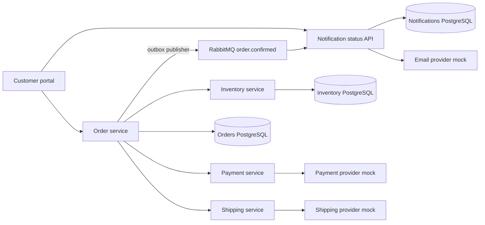

# Application overview

CommerceLens demonstrates a commerce checkout across six services. The portal presents products, cart, checkout and operational information. Order coordinates stock reservation, payment and shipment; a durable event drives email notification.

## Runtime topology

## Boundaries
Three PostgreSQL databases have separate owners: Order, Inventory and Notification. Payment and Shipping have no application database. The three provider roles are implemented by one local `mock-providers` container with SQLite persistence. They represent external business dependencies, but no real vendor is contacted by this deployment.

The portal is published at localhost:3000. Nginx routes business API requests into the internal Compose network. RabbitMQ management is exposed on localhost:15672; database and business API ports are not published.

## Current scope
The six business services, portal, Graphify artifacts and service OpenWiki documentation exist. This catalog describes their static architecture and source behavior. Pinecone ingestion, the application assistant/chat UI and the RAG evaluation harness remain future work. Documentation cannot establish live operational status.

## Source evidence

[Reviewed source snapshot](../catalog/source-evidence.json) and [deployment configuration](../compose.yaml). Original source baseline:

- [customer-portal: nginx.conf](https://github.com/nagv/commercelens-customer-portal/blob/1d444dcaa6e0bf3ffb2dd9254c6430ad501c6f95/nginx.conf)
- [order-service: src/main/java/com/commercelens/orders/OrderStore.java](https://github.com/nagv/commercelens-order-service/blob/cd8bdf02b98c4033b203fe554e12d95a46a13225/src/main/java/com/commercelens/orders/OrderStore.java)
- [order-service: src/main/java/com/commercelens/orders/OutboxPublisher.java](https://github.com/nagv/commercelens-order-service/blob/cd8bdf02b98c4033b203fe554e12d95a46a13225/src/main/java/com/commercelens/orders/OutboxPublisher.java)
- [order-service: src/main/java/com/commercelens/orders/Checkout.java](https://github.com/nagv/commercelens-order-service/blob/cd8bdf02b98c4033b203fe554e12d95a46a13225/src/main/java/com/commercelens/orders/Checkout.java)
- [inventory-service: main.go](https://github.com/nagv/commercelens-inventory-service/blob/160854d9317c07a55cb5a23703a0487bb98ab4d8/main.go)
- [notification-worker: src/main.ts](https://github.com/nagv/commercelens-notification-worker/blob/4159264c5465925d8edc99a21fb49565401967d5/src/main.ts)

[Master entry point](quickstart.md)
