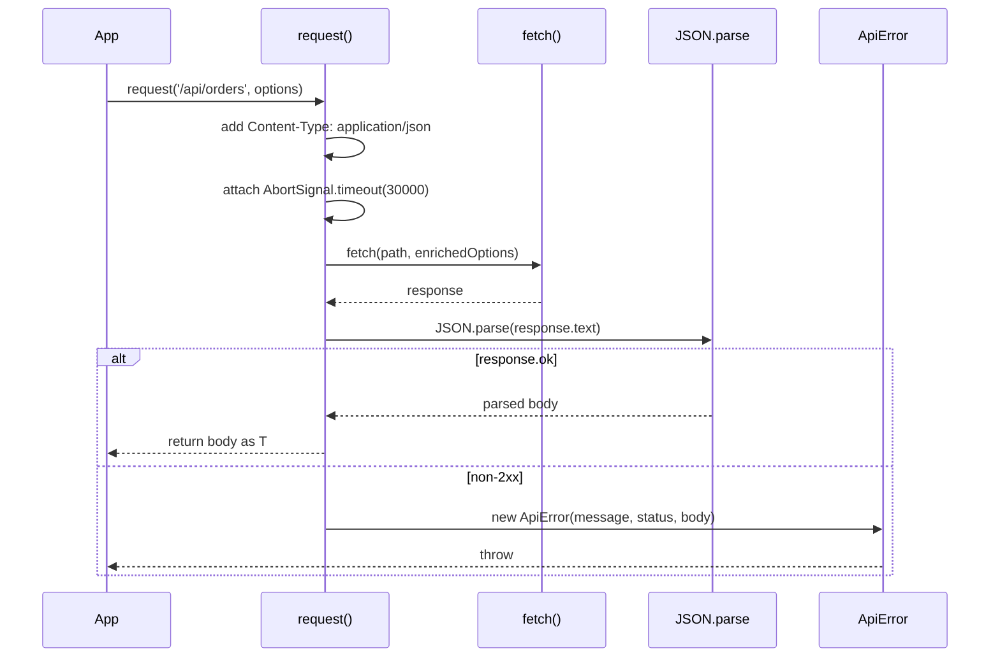

# API Client

The API client is a small, repository-specific wrapper around the browser `fetch` API.
It lives in [`src/api.ts`](repo://src/api.ts) and is consumed by [`src/main.tsx`](repo://src/main.tsx).

## Request lifecycle


*Typical request lifecycle: enrichment, fetch, JSON parse, and either success or an ApiError.*

## `request<T>(path, options)`

The [`request`](repo://src/api.ts#L4-L14) function is the single entry point for all outbound HTTP calls.

1. **Headers** — It injects `Content-Type: application/json` into the outgoing header map, merging with any headers supplied by the caller.
2. **Timeout** — It attaches `AbortSignal.timeout(30000)`, so every request aborts automatically if the server does not respond within **30 seconds**.
3. **JSON parsing** — It reads the response body as text, then calls `JSON.parse`. An unparsable body causes its own `ApiError` with the message *"Service returned an unreadable response. Check the services and retry."*
4. **Error handling** — On a non-2xx status, `request` throws an `ApiError` carrying the HTTP status code and the parsed body.

## `ApiError`

[`ApiError`](repo://src/api.ts#L1-L3) extends `Error` and exposes two extra fields:

- `status: number` — the HTTP status code
- `body: unknown` — the parsed JSON response body

### Surfacing backend messages

When a non-2xx response arrives, `request` inspects the body for the following fields, in order of preference, to build the error message:

1. `message`
2. `failureReason`
3. `detail` (only if it is a string)
4. A generic fallback: `Request failed (${status}).`

[`main.tsx`](repo://src/main.tsx#L38-L44) catches `ApiError` and either displays `e.message` or falls back to a generic connectivity message when the error is not an `ApiError`.

## Idempotency header for order creation

[`main.tsx`](repo://src/main.tsx#L38) sends a `POST /api/orders` with the header:

```ts
'Idempotency-Key': next.key
```

`next.key` is a stable idempotency key generated by [`checkoutAttempt`](repo://src/main.tsx#L34) and persisted in `sessionStorage`. If the user retries the checkout (for example after a network interruption or page reload), the same key is reused, making the POST retry-safe.

## Usage in the application

`request` is used for:

- `GET /api/products` — loading the product catalog  
  ([`main.tsx#L19`](repo://src/main.tsx#L19))
- `GET /api/orders` — loading order history  
  ([`main.tsx#L19`](repo://src/main.tsx#L19))
- `GET /api/notifications` — loading notification records  
  ([`main.tsx#L19`](repo://src/main.tsx#L19))
- `POST /api/orders` — submitting a checkout with idempotency  
  ([`main.tsx#L38`](repo://src/main.tsx#L38))
- `GET /api/orders/${id}` — fetching an individual order detail  
  ([`main.tsx#L50`](repo://src/main.tsx#L50))

## See also

- [Domain Models](./domain-models.md) — types consumed and produced by `request`
- [Service Context](../service-context.md) — how the backend services are wired
- [User Checkout](../workflows/user-checkout.md) — end-to-end checkout flow that uses the API client
