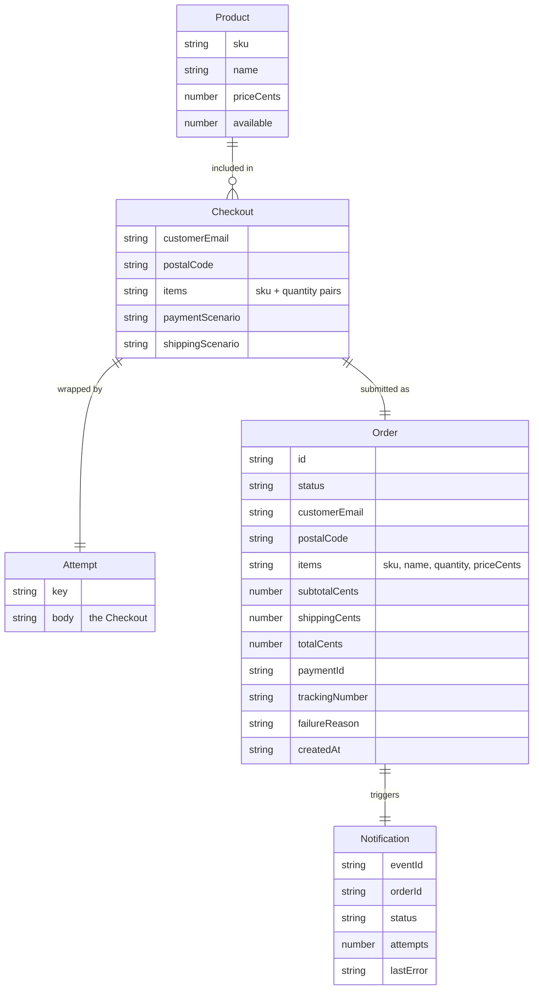

# Domain Models

The domain layer lives in [`src/domain.ts`](repo://src/domain.ts) and defines the storefront's core types and pure functions. It is consumed by [`src/main.tsx`](repo://src/main.tsx) and covered by [`src/domain.test.ts`](repo://src/domain.test.ts).

## Data model


*Entity relationships in the storefront domain: a Checkout is wrapped by an Attempt for idempotency and becomes a submitted Order, while each Order may trigger Notification delivery records.*

## Core types

These types are defined in [`src/domain.ts`](repo://src/domain.ts#L1-L5):

| Type | Shape |
|------|-------|
| **Product** | `{ sku: string; name: string; priceCents: number; available: number }` |
| **Checkout** | `{ customerEmail: string; postalCode: string; items: { sku: string; quantity: number }[]; paymentScenario: 'success' \| 'decline' \| 'timeout'; shippingScenario: 'success' \| 'failure' }` |
| **Attempt** | `{ key: string; body: Checkout }` |
| **Order** | `{ id: string; status: string; customerEmail: string; postalCode: string; items: { sku: string; name?: string; quantity: number; priceCents?: number }[]; subtotalCents: number; shippingCents: number; totalCents: number; paymentId?: string; trackingNumber?: string; failureReason?: string; createdAt: string }` |
| **Notification** | `{ eventId: string; orderId: string; status: string; attempts: number; lastError?: string }` |

### Key design notes

- **Product** and **Checkout** are the inputs the user controls; their fields are plain scalars or small nested objects.
- **Attempt** is an idempotency wrapper. It carries a stable `key` and an immutable snapshot of the `Checkout` body.
- **Order** is the shape returned by backend services after an order is placed, enriched with computed pricing and optional fulfillment fields.
- **Notification** tracks delivery outcomes for a given order, including retry counts and the last error.

## `cartSummary(products, cart)`

[`cartSummary`](repo://src/domain.ts#L6-L11) computes a price summary **entirely on the client**, using the local product list and the current cart map. It never trusts prices sent by the caller or the user.

- **Subtotal** is the sum of each product's `priceCents` multiplied by the quantity from the cart.
- **Shipping** is a flat `500` cents whenever `count > 0`; otherwise it is `0`.
- The function also returns the total (subtotal + shipping) and the total item count.

Tests in [`src/domain.test.ts`](repo://src/domain.test.ts#L7-L10) verify that the function calculates cents without relying on externally supplied prices.

## `validateCheckout(body, products)`

[`validateCheckout`](repo://src/domain.ts#L12-L22) is a pure guard that returns `null` when the checkout is valid, or a short human-readable error string otherwise.

<!-- openwiki: mermaid parse failed and this diagram was converted to a text fence so it does not break rendering. Fix the diagram source and restore the mermaid fence. Parser error: Heuristic: an unescaped angle bracket inside a label breaks rendering; rephrase the label. -->
```text
flowchart TD
    A["validateCheckout body"]
    B{"items.length > 0"}
    C["reject: Add a product"]
    D{"email matches regex"}
    E["reject: valid email"]
    F{"postalCode 1-20 chars"}
    G["reject: postal code"]
    H{"every item valid"}
    I["reject: quantities"]
    J["reject: stock"]
    K["return null"]
    A --> B
    B -->|no| C
    B -->|yes| D
    D -->|no| E
    D -->|yes| F
    F -->|no| G
    F -->|yes| H
    H -->|non-integer| I
    H -->|out of stock| J
    H -->|all pass| K
```
*Decision logic in `validateCheckout`: each gate rejects with a specific message.*

Validation rules in order:

1. **Cart non-empty** — returns *"Add a product to your cart."*
2. **Email format** — matches `/^[^\s@]+@[^\s@]+\.[^\s@]+$/`; otherwise returns *"Enter a valid email address."*
3. **Postal code length** — trimmed length must be between `1` and `20`; otherwise returns *"Enter a postal code (up to 20 characters)."*
4. **Per-item quantity** — must be an integer `>= 1`; otherwise returns *"Quantities must be positive whole numbers."*
5. **Stock availability** — each item must exist in the product list and not exceed `available`; otherwise returns *"Your cart exceeds available stock. Refresh the catalog."*

[`src/domain.test.ts`](repo://src/domain.test.ts#L11-L16) exercises the empty cart, invalid email, insufficient stock, fractional quantity, and fully valid cases.

## `checkoutAttempt(body, previous, makeKey?)`

[`checkoutAttempt`](repo://src/domain.ts#L23-L25) ensures **idempotency on retries**.

- If `previous` is non-null (for example, a saved `Attempt` from an earlier try or a page reload), it is returned as-is.
- Otherwise, a new `Attempt` is created with a fresh UUID key and a [structuredClone](https://developer.mozilla.org/en-US/docs/Web/API/structuredClone) of the current `body`.

This means the first attempt pins the checkout payload and the idempotency key; subsequent retries reuse both, even if the user has modified form fields in the UI. [`src/domain.test.ts`](repo://src/domain.test.ts#L18-L23) confirms that after a timeout, retries preserve the original postal code and key.

## `money(cents)`

[`money`](repo://src/domain.ts#L26) is a small formatter that converts a cent amount to a USD string using `Intl.NumberFormat`. For example, `money(2900)` yields `"$29.00"`.

## See also

- [API Client](./api-client.md) — how `request` sends the `Attempt` payload with an `Idempotency-Key` header
- [Testing Verification](../testing/verification.md) — broader test strategy
- [User Workflow: Checkout](../workflows/user-checkout.md) — end-to-end checkout flow from the user perspective
