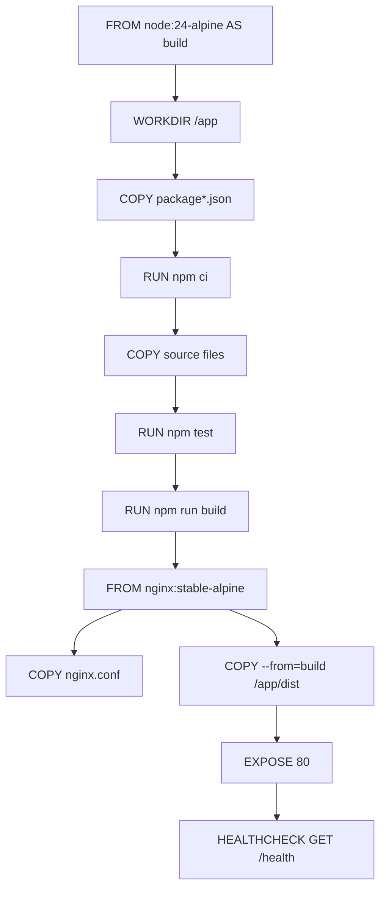

# Deployment and Infrastructure

The CommerceLens customer portal is packaged in a multi-stage Docker image. The build stage compiles and tests the application, and the runtime stage serves the resulting static assets through nginx. In local development, Vite proxies API calls directly to the backend services.

## Build and Runtime Pipeline

The container follows a two-stage build defined in the project `Dockerfile`.

*Docker multi-stage build flow from source to runtime container.*

The first stage uses `node:24-alpine` to install dependencies, run tests, and build the application. It copies `package.json` and `package-lock.json`, runs `npm ci` to install exact dependencies, then copies the remaining source files and runs `npm test` followed by `npm run build`. The `build` script performs TypeScript compilation (`tsc -b`) and then invokes Vite to generate the production asset bundle in `/app/dist`.

The second stage uses `nginx:stable-alpine`. It copies the built assets into `/usr/share/nginx/html`, copies the project `nginx.conf` to `/etc/nginx/conf.d/default.conf`, and exposes port 80. A `HEALTHCHECK` pings `GET /health` inside the container every 15 seconds with a 3-second timeout. If the endpoint does not respond, the container is marked unhealthy.

## Production Routing

The nginx configuration handles three categories of traffic on port 80:

- `/health` — Returns a JSON payload `{"status":"ok"}`. This endpoint reports only the availability of the nginx-served frontend container; it does not verify downstream services.
- `/api/notifications` — Proxied to the `notification-worker` service on port 8080.
- `/api/*` — All other API requests are proxied to the `order-service` on port 8080.
- All unmatched requests — The SPA fallback (`try_files`) serves `index.html`, allowing client-side routing to function correctly.

Both upstream API locations use `proxy_read_timeout 35s`, which allows slightly more time than the browser-facing 30-second request timeout so that nginx does not drop an upstream reply that arrives just after the client has given up.

## Development Proxy

During development, Vite replaces nginx. The `vite.config.ts` configures a server-side proxy that mirrors the production routing split locally:

- `/api/notifications` is forwarded to `http://127.0.0.1:8085`
- `/api` is forwarded to `http://127.0.0.1:8080`

This lets developers run the frontend with `npm run dev` while the backend services run on the referenced local ports without needing CORS or a separate reverse proxy.

## Verification and Operations

Before an image is produced, the build stage validates the codebase through `npm test` (Vitest) and type-checks with `tsc -b`. Those same steps are executed automatically during every Docker build, so the runtime image only includes assets that passed both validation gates. Production health check behavior is configured entirely inside the Dockerfile and checked at 15-second intervals.
