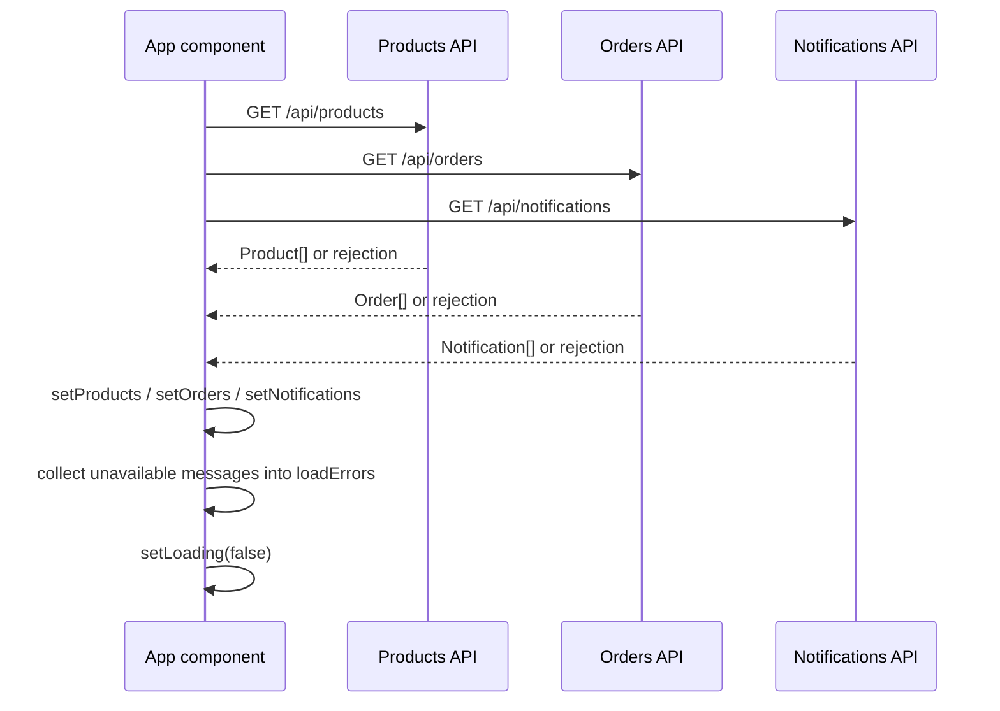

# Operations Monitoring Flow

The Operations tab is the observability view for the CommerceLens customer portal. It shows order history, delivery attempts, and lets users inspect individual order details.

## Refresh flow

On mount and on demand, the app calls three endpoints in parallel using `Promise.allSettled`. Each response updates its corresponding React state; failures are collected into `loadErrors` and rendered as non-fatal warnings.



*Refresh flow: three parallel fetches, then state updates, then loading ends.*

`request` is an internal HTTP helper imported from `src/api.ts`. See [API Client](../architecture/api-client.md). The application context lives in [Service Context](../service-context.md).

### Tolerant error handling

If any fetch fails, the app still displays data that succeeded. The `loadErrors` array is rendered as warning banners. Notification service unavailability is explicitly tolerated, and the banner phrasing reflects that orders can still be placed without it.

| Service | Success | Failure message |
| --- | --- | --- |
| Products | `setProducts` | "Catalog unavailable. Start inventory and order services." |
| Orders | `setOrders` | "Order history unavailable." |
| Notifications | `setNotifications` | "Notification worker unavailable. Orders can still be placed." |

## Operations tab layout

When the user selects the Operations tab, the view switches from the storefront to a dedicated section with metrics, an order activity table, and a notification delivery list.

### Metrics bar

Four summary cards are displayed at the top:

- **Orders recorded** — total count of orders.
- **Confirmed** — orders whose status equals `confirmed`.
- **Needs attention** — orders whose status is not `confirmed`.
- **Notification records** — total notification events.

### Order activity table

Columns:

| Column | Source |
| --- | --- |
| Order | `o.id.slice(0, 8)` |
| Customer | `o.customerEmail` |
| Status | `<Status value={o.status} />` |
| Total | `money(o.totalCents)` |
| Created | `new Date(o.createdAt).toLocaleString()` |

Each row includes a **Details** button. If no orders exist, an empty placeholder explains that placing a demo order in the storefront will populate the table.

### Notification delivery list

Below the order table, a list renders each notification record as a card with:

- `eventId` shown as a short code: `n.orderId.slice(0, 8)`.
- `status` rendered with the same `<Status>` component used in the order table.
- Attempt count: dynamic pluralization of "delivery attempt(s)".
- `lastError` shown in a highlighted failure style when present.

If no notifications exist, a muted message explains that records appear after confirmed orders are consumed.

## Order detail view

Clicking **Details** on a row triggers `detail(id)`, which sends:

```
GET /api/orders/{id}
```

On success, the returned `Order` opens in a detail section that overlays the current view. It shows the following fields:

- `status` (rendered with `<Status>`)
- `customerEmail`
- `totalCents` (formatted via `money`)
- `paymentId` (or "Not available")
- `trackingNumber` (or "Not available")
- `failureReason` (shown only when present)
- Line items (`items` array), each shown as `name || sku × quantity`

A Close button clears `selected` from state.

## Related areas

- [API Client](../architecture/api-client.md) — HTTP request helper and error types.
- [Service Context](../service-context.md) — application-level state and domain types.
