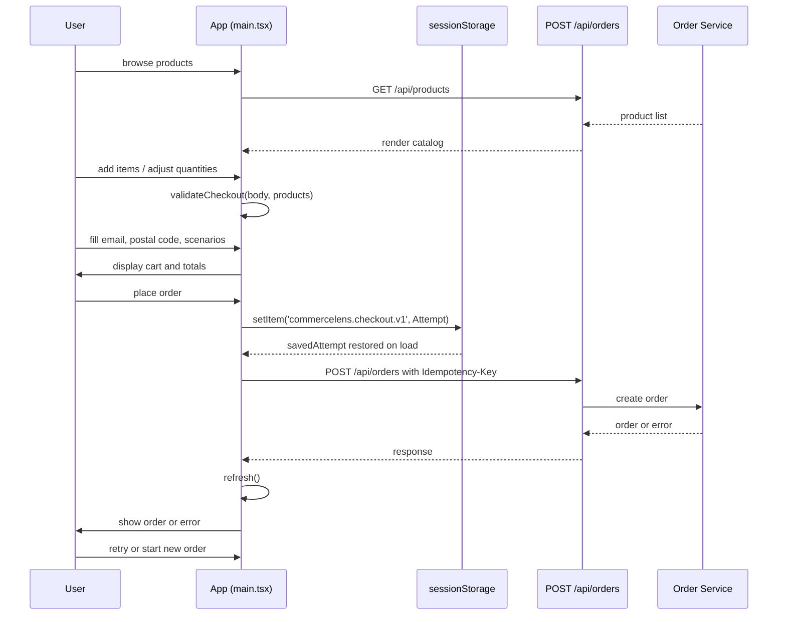

# User Checkout Flow

The checkout flow lets a shopper browse products, manage a cart, fill checkout details, submit an order, and review the result. The entire flow lives in the single-page React application rooted at [`src/main.tsx`](repo://src/main.tsx). It is closely supported by the domain helpers in [`src/domain.ts`](repo://src/domain.ts), the API wrapper in [`src/api.ts`](repo://src/api.ts), and the types documented in the [Domain Models](../architecture/domain-models.md) and [API Client](../architecture/api-client.md) pages.

## Sequence overview

*Full checkout interaction from browsing through result display.*

## Browse and build the cart

When the application mounts, it calls `refresh()` which fetches the product catalog, order history, and notification records in parallel via `Promise.allSettled` ([`main.tsx#L17-L25`](repo://src/main.tsx#L17-L25)). Products are rendered with their SKU, name, price, and available stock.

Adding an item increments its quantity in a `Record<string,number>` cart state. Quantities are capped by the product's `available` field and the add button is disabled when the cart already holds the full stock ([`main.tsx#L60`](repo://src/main.tsx#L60)).

The cart supports in-place adjustment: an `<input type="number">` on each cart line lets the user raise or lower quantities, and setting a quantity to `0` removes the item entirely ([`main.tsx#L64`](repo://src/main.tsx#L64)). If the cart is empty a placeholder prompts the user to add an essential.

Prices are computed client-side by [`cartSummary`](repo://src/domain.ts#L6-L11) for display only. The backend always re-computes authoritative totals during order creation.

## Checkout form and test scenarios

The checkout panel collects:

- **Email address** — validated with a simple regex before submission.
- **Postal code** — trimmed; must be 1–20 characters.
- **Test scenarios** (expandable controls) — simulate outcomes for the payment provider (`success`, `decline`, `timeout`) and the shipping provider (`success`, `failure`).

An email containing `fail-email` triggers notification-retry dead-letter behavior on the backend.

## Validation

Before the first submission, [`validateCheckout`](repo://src/domain.ts#L12-L22) guards the form with the following checks in order:

1. Cart is not empty.
2. Email is well-formed.
3. Postal code is present and within length limits.
4. Every quantity is a positive integer.
5. No quantity exceeds the current available stock.

If validation fails, the first error message is shown to the user and the attempt stops.

Once an `Attempt` exists (see below), validation is skipped on retries so the same payload is resubmitted unchanged.

## Idempotency and sessionStorage persistence

The first time the user submits, `submit` calls [`checkoutAttempt`](repo://src/domain.ts#L23-L25) with the current payload and any previously saved `Attempt`:

- If there is **no previous attempt**, a new one is created with a fresh UUID key and a `structuredClone` of the body.
- If an attempt **already exists**, the original key and body are returned as-is, ignoring any form changes the user may have made in the meantime.

The attempt is persisted in tab-scoped `sessionStorage` under the key `commercelens.checkout.v1` ([`main.tsx#L8`](repo://src/main.tsx#L8)). On page load, `savedAttempt()` reads it back and restores the checkout state ([`main.tsx#L8`](repo://src/main.tsx#L8)).

Once an attempt exists, the form inputs lock, the add-to-cart buttons disable, and the UI presents **Retry / recover this order** and **Start a new order** options ([`main.tsx#L66`](repo://src/main.tsx#L66)).

## Submission and retry semantics

The `submit` handler builds a `Checkout` body from the current cart and form values, creates or reuses the `Attempt`, writes it to `sessionStorage`, and then POSTs to `/api/orders` with the header `Idempotency-Key: next.key` ([`main.tsx#L30-L38`](repo://src/main.tsx#L38-L38)).

While the request is in flight the UI shows a processing state and locks the primary action.

### Retry behavior

Because the attempt is pinned in `sessionStorage`, pressing **Retry / recover this order** after a failure resubmits the *exact same* payload and idempotency key. This lets the backend deduplicate the request safely even if the user's browser lost the original response.

## Error handling

The [`submit`](repo://src/main.tsx#L30-L44) catch block handles three categories of failure:

1. **Network interruption or timeout** — if the error is not an `ApiError`, the user sees: *"Connection interrupted. The order outcome may be unknown. Retry this same checkout to recover its status."* This frames the situation as an unknown outcome rather than a decline.

2. **Backend error that carries order data** — if the error body contains an `order` property, or an `id` plus `status`, the frontend treats it as a partial or existing order and displays the order details anyway ([`main.tsx#L41-L42`](repo://src/main.tsx#L41-L42)).

3. **Generic backend error** — if the error is an `ApiError` with no order payload, the message is surfaced from the response body (preferring `message`, then `failureReason`, then `detail`) and shown to the user.

After any outcome, `refresh()` is called to reload the catalog, orders, and notifications so the UI reflects the latest state.

## newOrder confirmation

When the user clicks **Start a new order**, [`newOrder`](repo://src/main.tsx#L46-L49) first shows a confirmation dialog:

> *"Start a different order? Check order history first: a previous payment may still be pending. Retrying the existing checkout is safer if its outcome is unknown."*

If the user confirms, the function clears:

- the `sessionStorage` entry for `commercelens.checkout.v1`
- the cart state
- any displayed error, notice, or selected order
- the active attempt state

This abandons the pinned idempotency key and lets the user create a fresh checkout.

## Result display

On a successful POST, the returned `Order` is stored in `selected` and rendered in an order-detail panel showing the order ID, status, customer email, total, tracking number, payment ID, item list, and any failure reason ([`main.tsx#L68`](repo://src/main.tsx#L68)).

The status is styled with a CSS class derived from its lowercase value, and underscores are replaced with spaces for readability.

## Related pages

- [Domain Models](../architecture/domain-models.md) — `Checkout`, `Attempt`, `Order`, and validation functions
- [API Client](../architecture/api-client.md) — `request` helper, `ApiError`, and timeout behavior
- [Service Context](../service-context.md) — backend service layout, proxy configuration, and health checks
