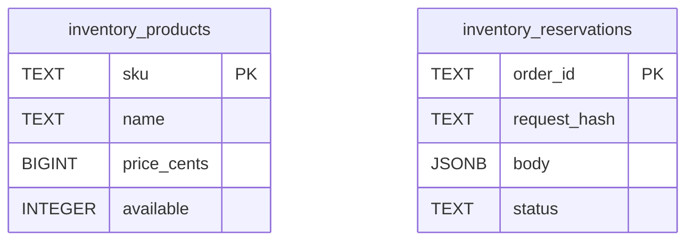

# Database Schema and Persistence

The inventory service persists all state in PostgreSQL through exactly two tables: `inventory_products` for catalog and stock counts, and `inventory_reservations` for reservation records.

## Tables

### inventory_products

| Column | Type | Constraints |
|--------|------|-------------|
| `sku` | `TEXT` | `PRIMARY KEY` |
| `name` | `TEXT` | `NOT NULL` |
| `price_cents` | `BIGINT` | `NOT NULL`, `CHECK(price_cents>0)` |
| `available` | `INTEGER` | `NOT NULL`, `CHECK(available>=0)` |

`available` tracks how many units remain in stock. A successful reservation decrements this value, and a release restores it.

### inventory_reservations

| Column | Type | Constraints |
|--------|------|-------------|
| `order_id` | `TEXT` | `PRIMARY KEY` |
| `request_hash` | `TEXT` | `NOT NULL` |
| `body` | `JSONB` | `NOT NULL` |
| `status` | `TEXT` | `NOT NULL` |

`request_hash` is a SHA-256 digest of the canonicalized item list, used to detect duplicate requests for the same order. `body` stores the full reservation result as JSON. Valid statuses are `"reserved"` and `"released"`.

There is no foreign key between the tables; reservations reference SKUs through the denormalized `body` JSON.

## Entity Relationship Diagram

Each entity uses a synthetic natural-key primary key. `inventory_products` and `inventory_reservations` are independent at the database level.

## Startup Schema Initialization

At startup, `main()` executes a const `schema` block that creates both tables with `IF NOT EXISTS`, then seeds three demo products using `ON CONFLICT DO NOTHING`. If the tables already exist the creation is a no-op, and inserts are silently skipped if the SKUs already exist.

## Locking Strategy

Concurrency is controlled by two complementary locks:

1. **Order-level serialization** — Before reading or writing a reservation, the transaction acquires a **pg_advisory_xact_lock** via `hashtextextended(orderId, 0)`. This serializes all operations for the same `order_id` across concurrent transactions, preventing duplicate reservations and race conditions during release.
2. **Inventory-level serialization** — Within the reservation transaction, `inventory_products` rows are selected with `FOR UPDATE` in ascending SKU order. Sorting before locking prevents deadlocks when multiple requests touch overlapping product sets, and the row-level lock guarantees the available-quantity check cannot be interleaved with another updater that would cause overselling.

## See Also

- [Reservation Flow](../runtime/reservation-flow.md)
- [Release Flow](../runtime/release-flow.md)
- [Service Overview](../service/overview.md)
- [Dependencies](../service/dependencies.md)
