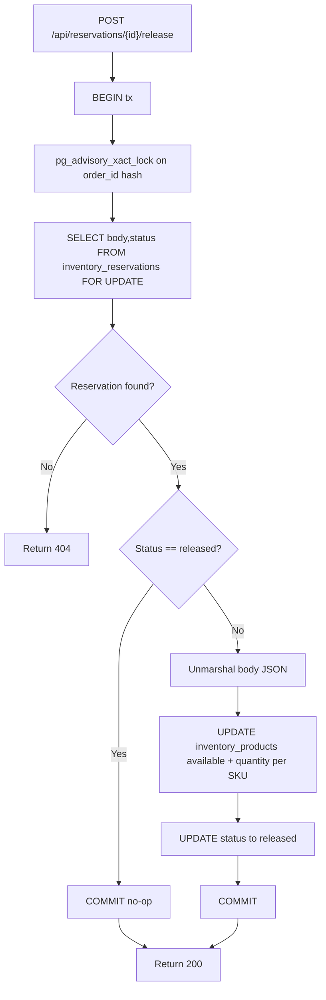

# Release Flow — End-to-End

Releasing a reservation means restoring reserved stock back to the product inventory and marking the reservation record as `released`. The operation is single-transactional and idempotent: replaying a release for an already-released reservation succeeds without changing data.

## HTTP Endpoint

The release endpoint is registered in the handler mux:

```go
mux.HandleFunc("POST /api/reservations/{id}/release", func(w http.ResponseWriter, r *http.Request) {
    ctx, cancel := context.WithTimeout(r.Context(), 5*time.Second)
    defer cancel()
    if err := s.release(ctx, r.PathValue("id")); err != nil {
        fail(w, err)
        return
    }
    write(w, 200, map[string]string{"status": "released"})
})
```

## Transactional Release Flow (`Store.release`)

The `release` method on `Store` performs all work inside one PostgreSQL transaction:

1. **Begin transaction.**
2. **Acquire order-level lock** using `pg_advisory_xact_lock(hashtextextended($1,0))` on the `order_id`. This serializes concurrent operations for the same order.
3. **Read reservation row** with `FOR UPDATE`:
   ```go
   SELECT body,status FROM inventory_reservations WHERE order_id=$1 FOR UPDATE
   ```
4. **If row not found** → return `404` (`reservation not found`).
5. **If status already `released`** → commit the transaction and return successfully. This is the idempotent no-op path.
6. **Unmarshal `body` JSON** into a `Reservation` to recover the SKUs and quantities.
7. **Restore stock** for each item:
   ```go
   UPDATE inventory_products SET available=available+$1 WHERE sku=$2
   ```
8. **Update reservation status** to `'released'`.
9. **Commit transaction.**

There is no compensation step, retry queue, or undo mechanism. If the transaction rolls back for any reason, the database state remains unchanged and the caller may retry.



Release returns an idempotent success when the status is already `released`.

## Idempotency Guarantees

- **Missing reservation**: a release for an unknown `order_id` returns `404`.
- **Replayed release**: a second release for the same already-released `order_id` commits the empty transaction and returns `200` with `{"status":"released"}`.
- **No double restore**: the check of `status == "released"` occurs before any `inventory_products` updates, so stock is never incremented twice.

These properties are exercised in the integration test that releases the same reservation twice and asserts the product `available` count only increases by the reserved quantity once.

## Failure Behavior

| Scenario | Result | Mechanism |
|----------|--------|-----------|
| Reservation does not exist | `404` | `pgx.ErrNoRows` from the `SELECT` is mapped to an `APIError` | | Already released | `200` (idempotent) | Early return after `status == "released"` check | | DB outage / transient error | `503` | `fail()` handler writes generic `503 inventory temporarily unavailable` |

## Data Model Dependencies

`release` touches the same two tables described in the [Database Schema](../data-model/schema.md):

- `inventory_reservations` — read `body` and `status`, update `status` to `released`.
- `inventory_products` — increment `available` per SKU.

## Related Flows

- [Database Schema](../data-model/schema.md)
