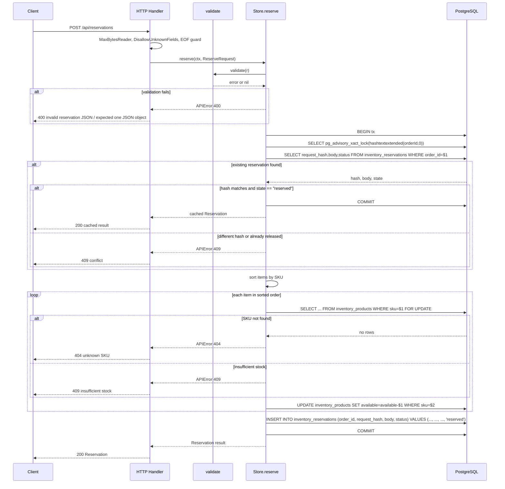

# Reservation Flow — End-to-End

Reserving inventory creates a provisional hold on stock for a given order. The flow is transactional and idempotent: replaying a reservation with the exact same request returns the cached result without modifying inventory again. The service exposes a single endpoint, performs strict input validation, uses PostgreSQL advisory and row-level locks to prevent race conditions, and returns clear HTTP status codes for every failure mode.

## HTTP Endpoint

The reservation handler is registered at `POST /api/reservations` in the handler mux:

```go
mux.HandleFunc("POST /api/reservations", func(w http.ResponseWriter, r *http.Request) {
    r.Body = http.MaxBytesReader(w, r.Body, 65536)
    decoder := json.NewDecoder(r.Body)
    decoder.DisallowUnknownFields()
    var body ReserveRequest
    if err := decoder.Decode(&body); err != nil {
        write(w, 400, map[string]string{"message": "invalid reservation JSON"})
        return
    }
    if err := decoder.Decode(&struct{}{}); err != io.EOF {
        write(w, 400, map[string]string{"message": "expected one JSON object"})
        return
    }
    ctx, cancel := context.WithTimeout(r.Context(), 5*time.Second)
    defer cancel()
    result, err := s.reserve(ctx, body)
    if err != nil {
        fail(w, err)
        return
    }
    write(w, 200, result)
})
```

`MaxBytesReader` limits request bodies to 64 KiB. `DisallowUnknownFields` rejects payloads with extra properties. The double-decode pattern ensures the body contains exactly one JSON object.

## Transactional Reservation Flow (`Store.reserve`)

The `reserve` method on `Store` performs all work inside one PostgreSQL transaction:

1. **Validate input.** Returns `400` if `orderId` is empty or longer than 100 characters, if there are no items or more than 100 items, if SKUs are not distinct, if any `quantity` is outside 1–1000, or if any SKU is empty or longer than 100 characters.
2. **Begin transaction.**
3. **Acquire order-level lock** using `pg_advisory_xact_lock(hashtextextended($1,0))` on the `order_id`. This serializes all operations for the same order across concurrent transactions.
4. **Check for an existing reservation** by `order_id`:
   - If the same `request_hash` and `status == "reserved"` → unmarshal the cached `body` JSON, commit, and return the stored result (idempotent replay).
   - If a different `request_hash` or `status == "released"` → return `409` (`reservation already exists with different items or was released`).
   - If no row exists → continue.
5. **Sort items by SKU** ascending. This ordering is used both for the fingerprint and for `FOR UPDATE` row lock acquisition, preventing deadlocks when multiple requests touch overlapping product sets.
6. **For each item**, select the product row with `FOR UPDATE`:
   - If the SKU does not exist → return `404` (`unknown SKU: ...`).
   - If `available < quantity` → return `409` (`insufficient stock: ...`).
   - Otherwise decrement `available` by `quantity`.
7. **Build the result** with authoritative `Name` and `PriceCents` from the database rows, compute `SubtotalCents`, and set `Status` to `"reserved"`.
8. **Marshal the result** to JSON.
9. **Insert** a new row into `inventory_reservations` with `order_id`, `request_hash`, `body`, and `status`.
10. **Commit transaction** and return the `Reservation`.

The request hash is a SHA-256 digest of the items sorted by SKU and serialized as JSON. Because the sort is deterministic, two identical requests always produce the same hash.



*Sequence of a complete reservation from HTTP handler to committed transaction.*

<!-- openwiki: mermaid parse failed and this diagram was converted to a text fence so it does not break rendering. Fix the diagram source and restore the mermaid fence. Parser error: Heuristic: an unescaped angle bracket inside a label breaks rendering; rephrase the label. -->
```text
flowchart TD
    A["POST /api/reservations"] --> B["MaxBytesReader / DisallowUnknownFields / EOF guard"]
    B --> C["validate (orderId, items, distinct SKUs, qty limits)"]
    C -- "invalid" --> D["Return 400"]
    C -- "valid" --> E["BEGIN tx"]
    E --> F["pg_advisory_xact_lock on order_id hash"]
    F --> G["SELECT existing reservation"]
    G -- "found, same hash, reserved" --> H["Unmarshal cached body"]
    H --> I["COMMIT"]
    I --> J["Return 200 cached"]
    G -- "found, different or released" --> K["Return 409 conflict"]
    G -- "not found" --> L["Sort items by SKU"]
    L --> M["FOR UPDATE select product row"]
    M -- "unknown SKU" --> N["Return 404"]
    M -- "found" --> O{"available >= quantity?"}
    O -- "No" --> P["Return 409 insufficient stock"]
    O -- "Yes" --> Q["UPDATE available = available - quantity"]
    Q --> R{"More items?"}
    R -- "Yes" --> M
    R -- "No" --> S["INSERT inventory_reservations"]
    S --> T["COMMIT"]
    T --> U["Return 200 Reservation"]
```

*Branching control flow through validation, replay detection, stock checks, and final insert.*

## Failure Behavior

There are no retries, exponential backoff, or dead-letter mechanisms in the service. Every error is returned to the caller immediately.

| Scenario | Status | Mechanism |
|----------|--------|-----------|
| JSON decode failure or extra fields | `400` | `json.NewDecoder` with `DisallowUnknownFields` or `Decode` error in the HTTP handler |
| Multiple JSON objects in body | `400` | Second `Decode` call fails `io.EOF` guard |
| Invalid `orderId` length, missing items, non-distinct SKUs, or quantity out of range | `400` | `validate()` returns an `APIError` with status 400 |
| Unknown SKU | `404` | `pgx.ErrNoRows` from `FOR UPDATE` select mapped to `APIError` |
| Insufficient stock | `409` | `available < quantity` check in `reserve()` |
| Reservation exists with different items or was already released | `409` | Request hash mismatch or `status != "reserved"` on existing row |
| Database or transient error | `503` | `fail()` catches non-APIError errors and writes generic `503 inventory temporarily unavailable` |

## Idempotency Guarantees

- **Exact replay**: submitting the same `orderId` and identical items a second time returns the previously computed `Reservation` from `inventory_reservations.body` without decrementing stock again.
- **Changed request**: any difference in items or quantities produces a different request hash and returns `409`.
- **Released order**: re-reserving an order that has already been released returns `409`.

These properties are exercised by the integration test that replays an exact request successfully and then asserts that a modified request is rejected.

## Data Model Dependencies

`reserve` touches the two tables described in the [Database Schema](../data-model/schema.md):

- `inventory_products` — read `available`, decrement on success.
- `inventory_reservations` — read `request_hash`/`body`/`status` for replay detection, insert new row on success.

## Concurrency Safety

Two locking layers prevent race conditions:

1. **Order-level serialization** — `pg_advisory_xact_lock` on `hashtextextended(orderId, 0)` ensures that concurrent requests for the same `order_id` serialize before any read or write.
2. **Inventory-level serialization** — `FOR UPDATE` row locks are acquired in ascending SKU order. Sorting before locking prevents deadlocks when multiple reservations touch overlapping product sets, and the row-level lock guarantees the available-quantity check cannot interleave with another updater that would cause overselling.

The integration test spawns 20 goroutines competing for 5 units of stock and confirms that exactly 5 reservations succeed, 0 units remain, and stock is never negative.

## Related Pages

- [Release Flow](release-flow.md)
- [Database Schema](../data-model/schema.md)
