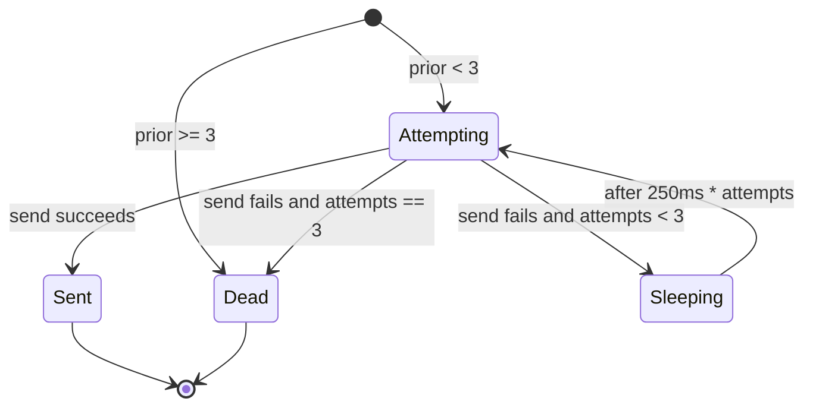

# Delivery and Retry Logic

This page documents the core delivery mechanism for order-confirmed email notifications. The [`deliver()`](repo://src/delivery.ts) function manages bounded retry attempts with linear backoff, preserves prior attempt counts across restarts, and enforces an idempotency contract keyed by `eventId`. It is consumed by the worker loop in [`main.ts`](repo://src/main.ts) and exercised by [`delivery.test.ts`](repo://test/delivery.test.ts).

## Event Type and Validation

Every message consumed from the `order.confirmed` queue is parsed as an `Event` before any delivery logic runs.

### Event Fields

| Field | Type | Constraints |
|-------|------|-------------|
| `eventId` | `string` | Non-empty, length 1–320 |
| `orderId` | `string` | Non-empty, length 1–320 |
| `customerEmail` | `string` | Non-empty, length 1–320, must contain `@` |
| `totalCents` | `number` | Safe integer, `>= 0` |
| `trackingNumber` | `string` | Non-empty, length 1–320 |

### parseEvent Rules

[`parseEvent(raw:string):Event`](repo://src/delivery.ts#L2-L6) performs strict validation:

1. Calls `JSON.parse(raw)`.
2. Checks that `eventId`, `orderId`, `customerEmail`, and `trackingNumber` are all strings with length greater than `0` and at most `320`.
3. Checks that `totalCents` is a safe integer and non-negative.
4. Checks that `customerEmail` contains the `@` character.
5. Throws `'Invalid order.confirmed event'` if any check fails.

This guarantees that every downstream component, including the database and the email provider, receives a well-formed payload.

## The deliver() Function

[`deliver()`](repo://src/delivery.ts#L7-L15) is a generic retry wrapper with four parameters:

| Parameter | Type | Purpose |
|-----------|------|---------|
| `prior` | `number` | Number of attempts already recorded for this event (budget consumed so far). |
| `send` | `() => Promise<void>` | The actual delivery call (e.g., HTTP POST to provider). |
| `beforeAttempt` | `(attempt:number) => Promise<void>` | Side-effect hook run before each delivery attempt; in production this updates the database row with the current attempt count. |
| `sleep` | `(ms:number) => Promise<void>` | Optional delay between retries; defaults to `setTimeout`. |

### Attempt Budgeting

The function caps total attempts at **3**. The loop condition is `while(attempts < 3)`, where `attempts` starts at `prior`. This means:

- If `prior === 0`, attempts 1, 2, and 3 are made.
- If `prior === 1`, attempts 2 and 3 are made.
- If `prior === 2`, only attempt 3 is made.
- If `prior >= 3`, no attempts are made and the function returns `dead` immediately.

This **prior-attempt preservation** ensures that crashes or restarts do not reset the retry counter. The count stored in PostgreSQL is fed back into `deliver()` on the next message consumption.

### Retry Loop and Backoff

Inside the loop:

1. `attempts` is incremented.
2. `beforeAttempt(attempts)` is awaited.
3. `send()` is awaited.
4. On success, the function returns `{status:'sent',attempts,lastError:null}`.
5. On failure, `lastError` is set to the error message (or `'Provider failure'` for non-Error throws).
6. If `attempts < 3`, the function sleeps for `250ms * attempts` before the next iteration.
7. When the loop exits without success, it returns `{status:'dead',attempts,lastError}`.

The backoff is **linear per-attempt**: 250 ms after attempt 1, 500 ms after attempt 2. There is no jitter or exponential growth.


*State diagram showing the delivery attempt lifecycle: attempting, optional sleeping, and terminal sent or dead states.*

## Idempotency Contract

The `eventId` field serves as the **Idempotency-Key**. The worker in `main.ts` passes it as the `Idempotency-Key` HTTP header on every POST to the email provider:

```javascript
await fetch((process.env.EMAIL_PROVIDER_URL ?? 'http://mock-provider:8080') + '/email', {
  method: 'POST',
  headers: {
    'Content-Type': 'application/json',
    'Idempotency-Key': event.eventId
  },
  body: JSON.stringify(event),
  signal: AbortSignal.timeout(Number(process.env.PROVIDER_TIMEOUT_MS ?? 3000))
});
```

The provider is expected to durably deduplicate requests carrying the same key so that retries do not cause duplicate emails. The worker also uses a PostgreSQL advisory lock keyed by the hash of `eventId` to serialize delivery attempts for the same event across multiple worker instances.

## Integration in main.ts

The delivery function is wired into the AMQP consumer loop in [`main.ts`](repo://src/main.ts#L31-L61) as follows:

1. `parseEvent` validates the AMQP message payload.
2. A PostgreSQL advisory lock is acquired on `hashtext(event.eventId)`.
3. The event is upserted into `notification_deliveries` with `ON CONFLICT DO NOTHING`.
4. The database payload is compared with the current message payload; mismatches are rejected with a negative acknowledgement (no retry).
5. If the row is already `sent`, the message is acknowledged immediately.
6. If the row is already `dead`, the message is rejected without retry.
7. Otherwise, `deliver()` is invoked with `record.attempts` as the prior count.
8. The `send` callback performs the HTTP POST and validates the response body `{status:'sent'}`.
9. The `beforeAttempt` callback updates `notification_deliveries.attempts` in the database.
10. After `deliver()` returns, the final `status`, `attempts`, and `lastError` are persisted, and the AMQP message is either acked (sent) or nacked without requeue (dead).

This design preserves exactly-once delivery semantics at the worker level, assuming the provider honours the Idempotency-Key contract.

## Terminal Outcomes

`deliver()` always returns an object with one of two terminal statuses:

### sent

- `status: 'sent'`
- `attempts`: the attempt number that succeeded
- `lastError: null`

The event is considered successfully delivered.

### dead

- `status: 'dead'`
- `attempts`: the final attempt count (at most 3)
- `lastError`: the error message from the last failed attempt, or `'Attempt limit reached'` when entering dead immediately because `prior >= 3`

The message is sent to the dead-letter queue `order.confirmed.dead` by the negative acknowledgement in `main.ts`.

## Test Coverage

[`test/delivery.test.ts`](repo://test/delivery.test.ts) covers three key behaviours:

1. **Validation rejects malformed events** – asserts that `parseEvent` throws on `{}` and on invalid JSON, and accepts a well-formed payload.
2. **Bounded attempts stop after success and preserve prior attempts** – starts with `prior=1`, forces one failure, then succeeds, verifying that the resulting status is `sent`, total attempts is `3`, and the recorded attempt numbers are `[2, 3]`.
3. **Three failures terminate as dead with no fourth attempt** – starts with `prior=0`, forces three failures, asserts `calls=3`, `status='dead'`, and that the `lastError` propagates the provider message.

The tests stub `sleep` with a no-op to keep execution synchronous.

## Related Pages

- [Message Consumption](../flows/message-consumption.md) – how AMQP messages are received, acknowledged, and dead-lettered.
- [Service Context](../service-context.md) – overall worker lifecycle, health checks, and shutdown behaviour.
