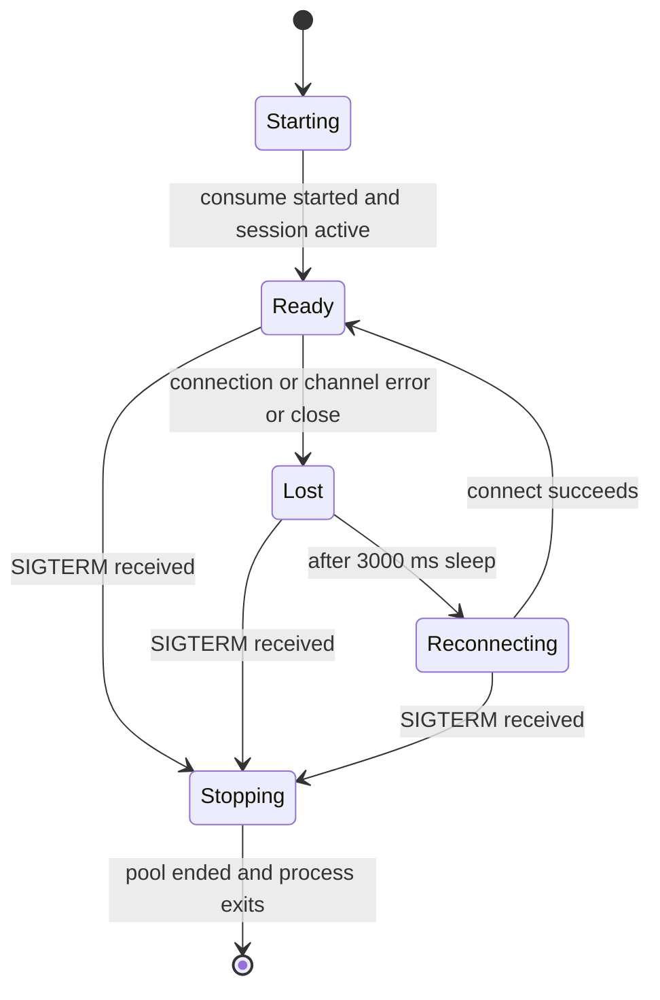

# Connection and Session Lifecycle

The worker keeps itself available through three cooperating mechanisms: a reconnect loop in [`main()`](../../src/main.ts), a per-session watcher in [`watchSession()`](../../src/lifecycle.ts), and a binary `ready` flag that drives the health endpoint. This page explains how they fit together and how the worker shuts down cleanly.

## Reconnect Loop

[`main()`](../../src/main.ts#L71) is the process-level anchor. It runs until the `stopping` flag is set:

```typescript
while (!stopping) {
  try {
    await connect();
  } catch (error) {
    ready = false;
    console.error('Worker startup/reconnect:', ...);
  }
  if (!stopping) await sleep(3000);
}
```

- Each iteration attempts to establish one fully operational session.
- If `connect()` throws — whether because RabbitMQ is down, the database is unreachable, or channel assertion fails — the worker marks itself not-ready, logs the failure, and waits **3000 ms** before trying again.
- When `connect()` returns cleanly (only after the session ends), the loop immediately starts the next connection attempt without an extra sleep, so recovery is instantaneous.

## Session Setup — `connect()`

[`connect()`](../../src/main.ts#L20-L70) performs all one-time startup work for a single session:

1. **Database schema** — creates `notification_deliveries` if it does not exist.
2. **AMQP connection** — opens a connection to the broker using `RABBITMQ_URL`.
3. **Session watcher** — wraps the connection with `watchSession`, passing a callback that clears `ready` when the session becomes unavailable.
4. **Channel and topology** — creates a channel, attaches it to the watcher, asserts `order.confirmed.dead` and `order.confirmed` (with dead-letter routing), and sets `prefetch(1)`.
5. **Consumer** — starts consuming from `order.confirmed`.
6. **Ready flag** — sets `ready = !session.ended` only after the consumer is active.
7. **Block** — awaits `session.done`, which resolves when the connection or channel fires an error or close event.
8. **Cleanup** — in a `finally` block, calls `session.stop()` and closes the AMQP connection. Closing the connection after a channel or startup failure prevents socket leakage.

## Ready-State Semantics

The `ready` boolean controls the [`GET /health`](../service-context.md) response (`200` when true, `503` when false). It is managed with three strict rules:

| Transition to `true` | Transition to `false` |
|---|---|
| After `channel.consume` succeeds **and** `session.ended` is still `false` ([`src/main.ts#L62`](../../src/main.ts#L62)). | `watchSession` callback when the connection or channel errors or closes ([`src/main.ts#L23`](../../src/main.ts#L23)). |
| | `connect()` throws before consume setup completes ([`src/main.ts#L71`](../../src/main.ts#L71)). |
| | `SIGTERM` handler fires ([`src/main.ts#L72`](../../src/main.ts#L72)). |

There is **no** intermediate "degraded" state: the worker is either ready to process messages or it is not.

## Session Watcher — `watchSession()`

[`watchSession()`](../../src/lifecycle.ts#L3-L15) is a small utility that turns AMQP `EventEmitter` events into a single, awaited `done` promise:

- It registers `error` and `close` listeners on the supplied connection.
- `watchChannel(channel)` adds the same listeners to a channel.
- `stop()` marks the session ended, invokes the caller-supplied `onUnavailable` callback **once**, and resolves `done`.
- The `ended` guard guarantees `onUnavailable` is never fired twice, even if both the connection and the channel emit events.
- The returned object exposes `done` (a Promise), `stop()` (manual teardown), and an `ended` getter.

Because `channel.on('error', stop)` remains active during teardown, Node.js will not crash from an unhandled `error` event while the channel is closing.

## Graceful Shutdown — `SIGTERM`

The `SIGTERM` handler is intentionally short and ordered:

1. Set `stopping = true` so the reconnect loop exits.
2. Set `ready = false` so load balancers stop routing traffic.
3. Close the HTTP server.
4. End the PostgreSQL pool.
5. Exit the process.

There is no waiting for in-flight messages; the AMQP connection is closed by `connect()`'s finally block as the loop terminates, and any message being processed at that moment is negatively acknowledged with requeue by the delivery `catch` block so another worker can pick it up.

## Lifecycle State Machine


*State transitions of a worker process from startup through ready, session loss, reconnect, and graceful shutdown.*

## Tests

[`test/lifecycle.test.ts`](../../test/lifecycle.test.ts#L1-L23) covers three invariants of `watchSession`:

1. **Channel error ends the session without duplicates** — emitting an `error` on the channel immediately sets `ended`, resolves `done`, and fires `onUnavailable` exactly once. Subsequent `close` events on either object are ignored.
2. **Channel-only close releases the reconnect loop** — a channel `close` ends the session even when the underlying connection remains open, allowing `connect()` to return so `main()` can reconnect.
3. **Early closure prevents readiness restoration** — if the connection closes before the consumer is established, `stop()` and `session.ended` remain true and `onUnavailable` is not invoked twice.

## See Also

- [Service Context](../service-context.md) — dependency contracts, configuration variables, and HTTP endpoint reference.
- [Message Consumption Flow](../flows/message-consumption.md) — how a single message moves from `channel.consume` through delivery, persistence, and acknowledgement.
