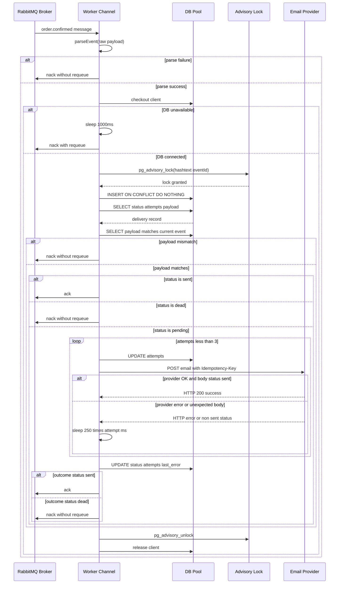

# Message Consumption Flow

This page traces the full lifecycle of a single `order.confirmed` RabbitMQ message through the notification worker, from the initial `channel.consume` callback to final acknowledgement or dead-lettering.

## Event Schema and Validation

Messages on the `order.confirmed` queue must carry a JSON payload matching this shape:

```ts
export type Event = {
  eventId: string;
  orderId: string;
  customerEmail: string;
  totalCents: number;
  trackingNumber: string;
};
```

The [`parseEvent`](../../src/delivery.ts) function enforces the following validation rules. If any check fails the message is immediately rejected.

| Rule | Criterion |
|------|-----------|
| Well-formed JSON | `JSON.parse` must succeed |
| Required string fields | `eventId`, `orderId`, `customerEmail`, `trackingNumber` must be strings |
| String bounds | Each string field length must be `> 0` and `<= 320` |
| Numeric validity | `totalCents` must be a non-negative safe integer |
| Email shape | `customerEmail` must include the character `@` |

If validation fails the worker calls `channel.nack(message, false, false)`, which routes the message to the dead-letter queue because requeue is disabled.

## Queue Topology and Prefetch

During startup [`connect()`](../../src/main.ts) asserts the queue topology:

- `order.confirmed.dead` is declared as a durable queue.
- `order.confirmed` is declared as durable with `x-dead-letter-exchange: ''` and `x-dead-letter-routing-key: 'order.confirmed.dead'`.
- The channel is configured with `prefetch(1)` so each worker processes only one message at a time.

## Consumption Flow

The following sections describe the flow in the order it executes inside the `channel.consume` callback.

### 1. Null-message guard

If the consumer receives a `null` message, the session is stopped and the callback returns immediately.

### 2. Parse the event

The raw payload is converted to a string and passed to `parseEvent`. On failure the message is negatively acknowledged without requeue, sending it to the dead-letter queue.

### 3. Acquire a database connection

The worker attempts to check out a client from the `pg.Pool`. If the database is unavailable, the worker sleeps for `1000 ms`, then negatively acknowledges the message **with** requeue so RabbitMQ will redeliver it to another worker or the same worker after recovery.

### 4. Advisory-lock deduplication

Once a database client is available the worker acquires a PostgreSQL advisory lock keyed to `hashtext(event.eventId)`. This serializes processing of the same event across multiple concurrent workers without relying on a transaction rollback to undo state changes on crash.

### 5. Upsert and read delivery record

The worker inserts a row into `notification_deliveries` with `ON CONFLICT DO NOTHING`. It then queries the existing row for `status`, `attempts`, and `payload`.

### 6. Payload-mismatch idempotency check

A second query compares the stored `payload` JSONB column with the current event using an exact JSONB equality check. If the payloads do not match, the worker dead-letters the message. This prevents idempotency-key collision across semantically different events.

### 7. Status gates

Before attempting delivery the worker checks the persisted status:

- **`sent`** — the message is acknowledged and the callback returns early.
- **`dead`** — the message is negatively acknowledged without requeue and moved to the dead-letter queue.
- **`pending`** — the worker proceeds to provider delivery.

### 8. Provider delivery with retry

The [`deliver`](../../src/delivery.ts) function is invoked with the prior attempt count. It performs up to three total attempts (including prior attempts) with an exponential sleep of `250 * attempt` milliseconds between retries.

A `beforeAttempt` hook updates the database `attempts` counter before each try. The `send` function itself performs a `POST` to the configured `EMAIL_PROVIDER_URL`, including an `Idempotency-Key` header set to `event.eventId` and an abort signal whose timeout defaults to `3000 ms`.

If the provider responds with a non-OK HTTP status, or the JSON body does not contain `status: 'sent'`, the attempt throws and `deliver` continues to the next retry.

### 9. Persist the final outcome

After `deliver` returns, the worker writes the final `status`, total `attempts`, `last_error`, and `updated_at` timestamp back to the delivery record.

### 10. Acknowledge or dead-letter

- If `outcome.status` is `sent`, the message is acknowledged.
- If `outcome.status` is `dead`, the message is negatively acknowledged without requeue.

### 11. Cleanup

In a `finally` block the advisory lock is released and the database client is returned to the pool. If unlocking fails the client is marked as broken so the pool discards it rather than reusing a potentially dirty connection.

### 12. Interrupted-delivery recovery

Any unexpected error that occurs **after** the database connection is acquired and **after** the advisory lock is held — for example a network partition during the provider call — is caught by an outer `catch` block. The worker sleeps for `1000 ms`, then negatively acknowledges the message **with** requeue, allowing redelivery and retry from a clean state.

## Non-Atomic Delivery and Acknowledgment

The provider HTTP call and the RabbitMQ `ack` or `nack` are **not** enclosed in a single distributed transaction. It is possible for the email provider to accept a request and for the worker to crash before it can acknowledge the message. The `Idempotency-Key` header mitigates duplicate sends on retry, and the `sent` status gate prevents the worker from re-sending after it has recorded success in the database.

This same gap exists on the failure path: a message may be dead-lettered in RabbitMQ while the provider logs show a slow or timed-out request that was eventually processed.

## Sequence Diagram


Worker crash or unexpected error during provider call triggers the interrupted-delivery path: the outer catch block sleeps, nacks with requeue, and releases the lock and client in `finally`.

## See Also

- [Delivery and Retry](../concepts/delivery-retry.md)
- [Lifecycle Management](../concepts/lifecycle.md)
- [Service Context](../service-context.md)
