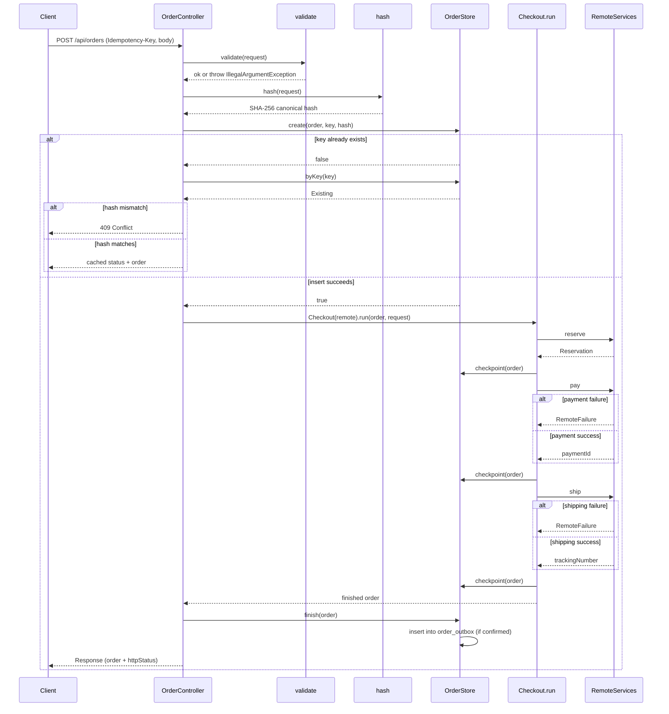

# HTTP API Surface and Idempotency

`OrderController` exposes a small REST surface for order lifecycle management, health checks, and a product-catalog proxy. All endpoints are defined in `OrderController.java` as a single `@RestController`.

---

## Endpoints

### GET /health

```java
@GetMapping("/health")
public ResponseEntity<?> health()
```

Returns `200 OK` with `{"status":"ok"}` when the application can reach the database (verified by `OrderStore.healthy()`). Returns `503 Service Unavailable` when the database is unreachable.

### GET /api/products

```java
@GetMapping("/api/products")
public Object products()
```

Proxies the upstream inventory service product catalog. The implementation delegates to `RemoteServices.products()`, which performs an HTTP GET against the configured `inventory.url`.

### GET /api/orders

```java
@GetMapping("/api/orders")
public Object list()
```

Returns the most recent 200 orders persisted in `OrderStore`, ordered by `created_at DESC`.

### GET /api/orders/{id}

```java
@GetMapping("/api/orders/{id}")
public ResponseEntity<?> get(@PathVariable String id)
```

Returns the order body with the stored HTTP status when found. Returns `404 Not Found` with `{"message":"order not found"}` when the ID does not exist.

### POST /api/orders

```java
@PostMapping("/api/orders")
public ResponseEntity<?> create(
    @RequestHeader(value="Idempotency-Key",required=false) String key,
    @RequestBody Checkout.Request request)
```

Creates a new order via the checkout saga. This endpoint is idempotent and requires the `Idempotency-Key` header. On success, returns the completed order with status `201 Created`. On replay of an identical request, returns the cached outcome. See [Idempotency](#idempotency) below.

---

## Request Body Schema

The `POST /api/orders` body deserializes into `Checkout.Request`:

```java
public record Request(
    String customerEmail,
    String postalCode,
    List<Item> items,
    String paymentScenario,
    String shippingScenario
) {}

public record Item(String sku, int quantity) {}
```

### Validation Rules

`Checkout.validate` enforces the following rules on every request:

| Field | Rule |
|---|---|
| `customerEmail` | Required. Must match `^[^\s@]+@[^\s@]+\.[^\s@]+$`. Maximum length 254. |
| `postalCode` | Required. Must match `^[A-Za-z0-9 -]{3,16}$`. |
| `items` | Required. Must contain 1–100 entries. |
| `items[].sku` | Required. Alphanumeric, hyphens, and underscores only (`^[A-Za-z0-9_-]{1,100}$`). Must be distinct across the array. |
| `items[].quantity` | Required. Integer between 1 and 1000 inclusive. |
| `paymentScenario` | Optional. If present, must be one of `success`, `decline`, `timeout`. Defaults to `success`. |
| `shippingScenario` | Optional. If present, must be one of `success`, `failure`. Defaults to `success`. |

Validation failures raise `IllegalArgumentException` and surface as `400 Bad Request`.

---

## Exception Handling

`OrderController` declares three `@ExceptionHandler` methods:

| Exception | Handler Method | HTTP Status | Body |
|---|---|---|---|
| `IllegalArgumentException` | `bad` | `400 Bad Request` | `{"message": exception.getMessage()}` |
| `HttpMessageNotReadableException` | `bad` | `400 Bad Request` | `{"message":"invalid JSON request"}` |
| `Checkout.RemoteFailure` | `upstream` | The upstream status code (`e.status`) | `{"message": exception.getMessage()}` |

The `RemoteFailure` handler maps upstream service failure statuses directly. When the payment or inventory service returns a non-2xx response, `Checkout.RemoteFailure` carries that status forward to the caller.

---

## Idempotency

The `POST /api/orders` endpoint is idempotent via an `Idempotency-Key` header.

### Header Format

- Name: `Idempotency-Key`
- Required: yes
- Format: `^[A-Za-z0-9_-]{1,100}$` (1–100 letters, numbers, hyphens, or underscores)
- Violations raise `IllegalArgumentException` → `400 Bad Request`.

### Request Hash

Before saga execution, the controller computes a SHA-256 hash over a **canonical JSON representation** of the request:

1. Items are sorted by `sku` ascending.
2. Default values are materialized for nullable scenarios (`paymentScenario` defaults to `"success"`, `shippingScenario` defaults to `"success"`).
3. The canonical `Checkout.Request` is serialized with `ObjectMapper` and digested with `MessageDigest.getInstance("SHA-256")`.

This hash is stored alongside the idempotency key so that two semantically identical requests produce the same hash even if JSON field ordering differs.

### Storage Semantics

`OrderStore.create` inserts a row with `ON CONFLICT(idempotency_key) DO NOTHING`:

```java
public boolean create(Checkout.Order order, String key, String hash) {
    return jdbc.update("INSERT INTO orders(id,idempotency_key,request_hash,body) VALUES(?,?,?,?::jsonb) ON CONFLICT(idempotency_key) DO NOTHING",
        order.id, key, hash, encode(order)) == 1;
}
```

- If the insert succeeds (`true`), the saga proceeds.
- If the key already exists (`false`), the controller compares hashes:
  - **Same hash**: the request is a replay. The stored order (with its final HTTP status) is returned.
  - **Different hash**: the key was used with different input. Returns `409 Conflict` with `{"message":"Idempotency-Key already used with different request","id": existing.order().id}`.

This makes concurrent duplicate submissions safe: `OrderStoreTest` verifies that exactly one of eight concurrent threads succeeds for the same key.

---

## POST /api/orders Flow



The sequence shows the complete lifecycle: header validation, request hashing, idempotency-key insertion, saga execution with checkpoint persistence after each remote call, final `finish` (which writes the completed order body and optionally inserts a domain event into `order_outbox`), and the HTTP response.

---

## Related Pages

- [Checkout Saga](../architecture/checkout-saga.md) – the saga state machine and compensation logic
- [Data Model](../architecture/data-model.md) – the `orders` and `order_outbox` table schemas
- [Idempotency and Concurrency](../workflows/idempotency-and-concurrency.md) – operational guidance on replay, retries, and key management
