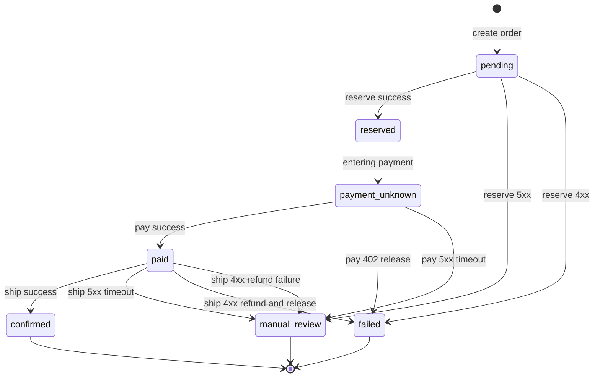

# Checkout Saga

The `Checkout` class is the saga coordinator for order placement. It orchestrates three remote effects—inventory reservation, payment, and shipping—by driving a single-threaded state machine inside `run`. It deliberately **does not retry external effects automatically after uncertain outcomes** (`repo://src/main/java/com/commercelens/orders/Checkout.java#L7`), so every failure branch ends in a determinate terminal state.

## State Machine

The saga follows ordered state transitions. The checkout request body begins as `pending`, moves through `reserved`, optionally enters `payment_unknown`, reaches `paid`, and finally becomes `confirmed`. Failure branches terminate in `failed` (resources were compensated) or `manual_review` (outcome is uncertain and human reconciliation is required).

**Caption:** Complete checkout saga state machine with terminal failure branches into `failed` and `manual_review`.

### Transition Details

- **`pending → reserved`**: `ports.reserve` succeeds and returns a `Reservation` containing line-item snapshots and an authoritative subtotal (`repo://src/main/java/com/commercelens/orders/Checkout.java#L41-L42`).
- **`reserved → payment_unknown`**: Immediately before calling `pay`, the status is persisted as `payment_unknown` so that a process crash here is never interpreted as "no charge was attempted" (`repo://src/main/java/com/commercelens/orders/Checkout.java#L43-L44`).
- **`payment_unknown → paid`**: `ports.pay` returns a payment provider ID (`repo://src/main/java/com/commercelens/orders/Checkout.java#L45`).
- **`payment_unknown → failed`**: Payment returns HTTP `402 Declined`. The saga releases the inventory reservation and terminates (`repo://src/main/java/com/commercelens/orders/Checkout.java#L46`).
- **`payment_unknown → manual_review`**: Any payment failure *except* `402` (timeouts, `504`, `409`, `5xx`, transport errors) leaves the order in `payment_unknown`. The payment effect may or may not have completed; replaying the saga is blocked by the idempotency mechanism in `OrderController` (`repo://src/main/java/com/commercelens/orders/Checkout.java#L46`, `repo://src/main/java/com/commercelens/orders/OrderController.java#L18-L21`).
- **`paid → confirmed`**: `ports.ship` returns a tracking number (`repo://src/main/java/com/commercelens/orders/Checkout.java#L48`).
- **`paid → manual_review`**: Shipping returns HTTP `5xx`. The carrier may have accepted the shipment before the error, so both the payment and the reservation are retained for human review (`repo://src/main/java/com/commercelens/orders/Checkout.java#L49-L52`).
- **`paid → failed`**: Shipping returns a `4xx` error. The saga refunds the payment and releases the inventory reservation (`repo://src/main/java/com/commercelens/orders/Checkout.java#L53-L55`).
- **`paid → manual_review` (refund failure)**: If the refund call itself throws during the shipping-failure compensation path, the order moves to `manual_review` with a note that refund reconciliation is required (`repo://src/main/java/com/commercelens/orders/Checkout.java#L54`).

## The `Ports` Interface

Saga logic depends on the `Ports` abstraction to stay unit-testable and to keep HTTP specifics out of the state machine (`repo://src/main/java/com/commercelens/orders/Checkout.java#L20-L27`).

| Method | Contract |
|---|---|
| `reserve(orderId, request)` | Atomically reserve inventory. Returns `Reservation` with item snapshots and subtotal. Throws `RemoteFailure` on any non-2xx. |
| `pay(orderId, cents, scenario)` | Charge the customer. Returns a provider payment ID on success. Throws `RemoteFailure` on non-2xx or transport failure. |
| `ship(orderId, postalCode, scenario)` | Create a shipment. Returns a tracking number on success. Throws `RemoteFailure` on non-2xx or transport failure. |
| `release(orderId)` | Release inventory reservation. Should be idempotent. |
| `refund(paymentId, orderId)` | Refund the payment. Should be idempotent. |
| `checkpoint(order)` | **Optional default no-op.** Persist the current intermediate state so a crash is recoverable. |

`RemoteServices` is the production implementation. It wraps `java.net.http.HttpClient` with a 2-second connect timeout and 8-second request timeout, and it maps every non-2xx response into `Checkout.RemoteFailure` carrying the upstream HTTP status code (`repo://src/main/java/com/commercelens/orders/RemoteServices.java#L16-L25`).

`RemoteServices.checkpoint` delegates to `OrderStore.checkpoint` (`repo://src/main/java/com/commercelens/orders/RemoteServices.java#L34`).

### HTTP Endpoint Mapping

| Port | HTTP Method | Target URL Pattern |
|---|---|---|
| `reserve` | `POST` | `{inventory.url}/api/reservations` |
| `pay` | `POST` | `{payment.url}/api/payments` |
| `ship` | `POST` | `{shipping.url}/api/shipments` |
| `release` | `POST` | `{inventory.url}/api/reservations/{orderId}/release` |
| `refund` | `POST` | `{payment.url}/api/payments/{paymentId}/refund` |

(`repo://src/main/java/com/commercelens/orders/RemoteServices.java#L28-L33`)

The `request` helper also parses the error body and prefers a `message` or `detail` field when surfacing a failure (`repo://src/main/java/com/commercelens/orders/RemoteServices.java#L23`).

## Checkpointing and Crash Safety

`Checkout.run` calls `ports.checkpoint(order)` after **every** successful external effect and after each state mutation that must survive a crash (`repo://src/main/java/com/commercelens/orders/Checkout.java#L42-L47`). In production this is wired to `OrderStore.checkpoint`, which overwrites the `body` column on the `orders` row with the current `Order` serialized as JSONB (`repo://src/main/java/com/commercelens/orders/OrderStore.java#L20`).

This makes the saga **crash-resilient without automatic retry**:

1. If the process crashes after `payment_unknown` is checkpointed but before `pay` returns, restarting the thread is blocked by the `Idempotency-Key` guard in `OrderController`.
2. If the process crashes after `pay` succeeds but before `paid` is checkpointed, the caller never received a success response; replay is still blocked by idempotency.
3. The `payment_unknown` state explicitly encodes "payment was initiated, outcome unknown," so operators can reconcile with the payment provider before deciding whether to retry.

## Why `payment_unknown` Exists

Without `payment_unknown`, a crash between the `pay` call and its result would leave the order in `reserved`. A human operator might assume no charge was made and retry, potentially double-charging the customer. By entering `payment_unknown` first (`repo://src/main/java/com/commercelens/orders/Checkout.java#L43-L44`), the order clearly signals that an external money effect is in flight. The idempotency key stored in `OrderStore` prevents automatic replay, forcing explicit reconciliation.

When `pay` returns a `402`, the outcome is known (declined), so the saga transitions to `failed` and releases the inventory (`repo://src/main/java/com/commercelens/orders/Checkout.java#L46`). Any other failure status leaves the order in `payment_unknown` and returns the upstream status to the caller.

## Validation

Before entering the saga, `Checkout.validate` enforces business rules on the request (`repo://src/main/java/com/commercelens/orders/Checkout.java#L31-L37`):

- `customerEmail` must match an e-mail regex and be ≤ 254 characters.
- `postalCode` must match `^[A-Za-z0-9 -]{3,16}$`.
- `items` must contain 1–100 distinct SKUs.
- Each SKU must match `^[A-Za-z0-9_-]{1,100}$`; quantity must be 1–1000.
- `paymentScenario` must be `success`, `decline`, or `timeout` when supplied.
- `shippingScenario` must be `success` or `failure` when supplied.

Validation failures raise `IllegalArgumentException`, which `OrderController` maps to `400 Bad Request`.

## Test Coverage

`CheckoutTest` covers every failure branch with a `FakePorts` test double (`repo://src/test/java/com/commercelens/orders/CheckoutTest.java`).

| Test | Scenario | Expected Terminal State |
|---|---|---|
| `rejectsInvalidQuantitiesAndDuplicateSkus` | Bad request | `IllegalArgumentException` |
| `timeoutKeepsReservationForReconciliation` | Payment `504` timeout | `payment_unknown`, reservation retained |
| `declineReleasesReservation` | Payment `402` decline | `failed`, reservation released |
| `paymentConflictRetainsReservationForReconciliation` | Payment `409` conflict | `payment_unknown`, reservation retained |
| `shipmentFailureRefundsAndReleases` | Shipping `4xx` failure | `failed`, refund and release executed |
| `failedCompensationRequiresManualReview` | Shipping fails + refund throws | `manual_review` |
| `uncertainShipmentRetainsPaymentAndReservation` | Shipping `504` timeout | `manual_review`, nothing compensated |
| `successUsesAuthoritativePrices` | Happy path | `confirmed`, total includes authoritative subtotal |

Each test uses the `FakePorts` double to inject failures without hitting the network (`repo://src/test/java/com/commercelens/orders/CheckoutTest.java#L50-L57`), confirming that the saga state machine is deterministic and that compensation only runs when the outcome is known.

## Relationship to the Outbox

Once the saga reaches `confirmed`, `OrderStore.finish` writes the final order body and inserts a domain event into `order_outbox` (`repo://src/main/java/com/commercelens/orders/OrderStore.java#L21-L27`). `OutboxPublisher` then delivers the event to a RabbitMQ queue at-least-once, with consumers deduplicating by `eventId`. This decouples the transactional saga completion from downstream event consumers.

## Related Pages

- [HTTP API Surface and Idempotency](api-surface.md) – the REST entry point and idempotency-key semantics
- [Data Model](data-model.md) – `orders` and `order_outbox` table schemas
- [External Services](../integrations/external-services.md) – inventory, payment, and shipping provider contracts
- [Service Context](../service-context.md) – runtime topology and environment wiring
- [Test Strategy](../testing/test-strategy.md) – test pyramid and mocking conventions
- [Failure Handling](../workflows/failure-handling.md) – operational runbooks for `manual_review` and `payment_unknown` reconciliation
