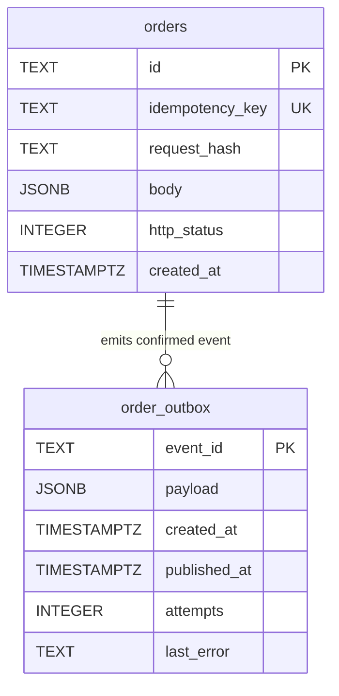

# Data Model and Persistence

The orders service keeps all mutable order state in a single PostgreSQL database. Two tables matter: `orders` stores the checkout saga state as a JSONB document, and `order_outbox` holds outbound domain events until they are delivered at-least-once.

## Entity Overview



**Caption:** Relationship between the `orders` saga state table and the `order_outbox` event table.

---

## The `orders` Table

The `orders` table is the durable log for every checkout attempt. It is designed to survive crashes and prevent replay of an in-flight saga.

| Column | Type | Constraint | Purpose |
|---|---|---|---|
| `id` | `TEXT` | `PRIMARY KEY` | Order identifier generated by the controller. |
| `idempotency_key` | `TEXT` | `UNIQUE NOT NULL` | Client-supplied key that prevents duplicate saga executions. |
| `request_hash` | `TEXT` | `NOT NULL` | SHA-256 digest of the canonical request so replays with different payloads are rejected. |
| `body` | `JSONB` | `NOT NULL` | The full `Checkout.Order` object serialized as JSONB. |
| `http_status` | `INTEGER` | `NOT NULL DEFAULT 409` | The HTTP status the controller should return for this order (e.g. 201 for confirmed, 409 for replay). |
| `created_at` | `TIMESTAMPTZ` | `NOT NULL DEFAULT now()` | Row creation timestamp. |

(`repo://src/main/resources/schema.sql#L1-L8`)

### Why `idempotency_key` is UNIQUE

The `idempotency_key` column has a database-level `UNIQUE` constraint so that two concurrent `POST /api/orders` requests with the same key cannot both spawn a new saga. `OrderStore.create` uses an `INSERT ... ON CONFLICT(idempotency_key) DO NOTHING` pattern (`repo://src/main/java/com/commercelens/orders/OrderStore.java#L15`). Only the transaction that wins the unique-index race returns `true`; the rest return `false` and the controller falls back to `byKey` to return the cached result.

`OrderStoreTest` verifies this directly: eight threads submit twenty concurrent inserts with the same key, and exactly one succeeds (`repo://src/test/java/com/commercelens/orders/OrderStoreTest.java#L15-L24`).

---

## The `order_outbox` Table

The outbox table decouples the local transaction that finishes an order from the downstream message broker. It follows the transactional outbox pattern.

| Column | Type | Constraint | Purpose |
|---|---|---|---|
| `event_id` | `TEXT` | `PRIMARY KEY` | Stable event identifier (e.g. `order-confirmed-{orderId}`). |
| `payload` | `JSONB` | `NOT NULL` | The domain event payload. |
| `created_at` | `TIMESTAMPTZ` | `NOT NULL DEFAULT now()` | When the event was written. |
| `published_at` | `TIMESTAMPTZ` | — | Set when the publisher receives a broker ACK. |
| `attempts` | `INTEGER` | `NOT NULL DEFAULT 0` | How many delivery attempts have been made. |
| `last_error` | `TEXT` | — | The most recent failure reason when delivery fails. |

(`repo://src/main/resources/schema.sql#L9-L16`)

`OutboxPublisher` polls `order_outbox` every two seconds, selects up to ten unpublished rows with `FOR UPDATE SKIP LOCKED`, sends each to a RabbitMQ queue named `order.confirmed`, and updates `published_at` only after the broker confirms the message (`repo://src/main/java/com/commercelens/orders/OutboxPublisher.java#L21-L33`). Because the outbox write happens inside the same local transaction that updates the order, a crash before the broker ACK leaves the event in the table for redelivery. Consumers deduplicate by `eventId`, giving at-least-once delivery semantics.

---

## JSONB Encoding and Decoding

`OrderStore` does not use JPA or an object-relational mapper. It delegates JSONB serialization to Jackson through two private helpers:

- `encode(Object value)` writes any `Checkout.Order` (or outbox event map) to a JSON string (`repo://src/main/java/com/commercelens/orders/OrderStore.java#L13`).
- `decode(String value, int status)` reads the JSON string back into a `Checkout.Order` instance and then overwrites the `httpStatus` field with the integer stored in the `http_status` column (`repo://src/main/java/com/commercelens/orders/OrderStore.java#L14`).

The `httpStatus` field on `Checkout.Order` is annotated with `@JsonIgnore` (`repo://src/main/java/com/commercelens/orders/Checkout.java#L16`), so Jackson never serializes it into the `body` column. Instead it lives in a dedicated SQL column and is re-injected on read. This keeps the HTTP transport concern separate from the domain model.

---

## OrderStore Operations

`OrderStore` is a Spring `@Repository` that wraps `JdbcTemplate`. Each method is small and maps directly to a single SQL statement.

### `create`

```java
public boolean create(Checkout.Order order, String key, String hash) {
    return jdbc.update(
        "INSERT INTO orders(id,idempotency_key,request_hash,body) " +
        "VALUES(?,?,?,?::jsonb) ON CONFLICT(idempotency_key) DO NOTHING",
        order.id, key, hash, encode(order)) == 1;
}
```

(`repo://src/main/java/com/commercelens/orders/OrderStore.java#L15`)

Inserts a new order with the generated id, the client idempotency key, the request hash, and the encoded JSONB body. Returns `true` if a row was inserted, `false` if the key already existed.

### `byKey`

```java
public Existing byKey(String key) {
    return jdbc.queryForObject(
        "SELECT request_hash, body::text, http_status FROM orders WHERE idempotency_key=?",
        (r, n) -> new Existing(r.getString(1), decode(r.getString(2), r.getInt(3))),
        key);
}
```

(`repo://src/main/java/com/commercelens/orders/OrderStore.java#L16`)

Used after a `create` returns `false`. It fetches the stored `request_hash` (so the controller can detect a different request replay) and the decoded order with its HTTP status.

### `get` and `list`

- `get(String id)` reads a single order by its primary key (`repo://src/main/java/com/commercelens/orders/OrderStore.java#L18`).
- `list()` returns the most recent 200 orders ordered by `created_at DESC` (`repo://src/main/java/com/commercelens/orders/OrderStore.java#L19`).

Both decode the JSONB body and inject the stored `http_status`.

### `checkpoint`

```java
public void checkpoint(Checkout.Order order) {
    jdbc.update("UPDATE orders SET body=?::jsonb WHERE id=?", encode(order), order.id);
}
```

(`repo://src/main/java/com/commercelens/orders/OrderStore.java#L20`)

Overwrites only the `body` column. The saga calls this after every successful remote effect and after each uncertain state mutation (for example, after entering `payment_unknown`), so a crash never loses intermediate progress.

### `finish`

```java
@Transactional
public void finish(Checkout.Order order) {
    jdbc.update("UPDATE orders SET body=?::jsonb, http_status=? WHERE id=?",
        encode(order), order.httpStatus, order.id);
    if ("confirmed".equals(order.status)) {
        String eventId = "order-confirmed-" + order.id;
        var event = Map.of(
            "eventId", eventId,
            "orderId", order.id,
            "customerEmail", order.customerEmail,
            "totalCents", order.totalCents,
            "trackingNumber", order.trackingNumber);
        jdbc.update(
            "INSERT INTO order_outbox(event_id,payload) VALUES(?,?::jsonb) ON CONFLICT DO NOTHING",
            eventId, encode(event));
    }
}
```

(`repo://src/main/java/com/commercelens/orders/OrderStore.java#L21-L28`)

This is the terminal write. It runs inside a `@Transactional` Spring method so the order update and the outbox insert are committed atomically. If the order status is `confirmed`, an event row is placed into `order_outbox` with a deterministic `event_id`. The `ON CONFLICT DO NOTHING` guard makes the finish method safe to retry.

### `healthy`

```java
public boolean healthy() {
    return Integer.valueOf(1).equals(jdbc.queryForObject("SELECT 1", Integer.class));
}
```

(`repo://src/main/java/com/commercelens/orders/OrderStore.java#L29`)

A simple liveness check used by the `/health` endpoint to confirm the database is reachable.

---

## Idempotency and Concurrency

Because `idempotency_key` is a `UNIQUE` index, the database is the single source of truth for whether a checkout has already started. The controller never needs distributed locking or external cache coordination. When two identical requests arrive simultaneously, PostgreSQL serializes the conflicting inserts; exactly one succeeds, and the other threads read the stored result via `byKey`.

See [Idempotency and Concurrency](../workflows/idempotency-and-concurrency.md) for operational guidance on key generation and replay policies.

---

## Related Pages

- [Checkout Saga](checkout-saga.md) — the saga state machine that drives checkpoint and finish calls
- [Outbox Publishing](outbox-publishing.md) — how `OutboxPublisher` delivers events at-least-once
- [Service Context](../service-context.md) — runtime topology and environment wiring
- [HTTP API Surface and Idempotency](api-surface.md) — the REST entry point and request hashing semantics
