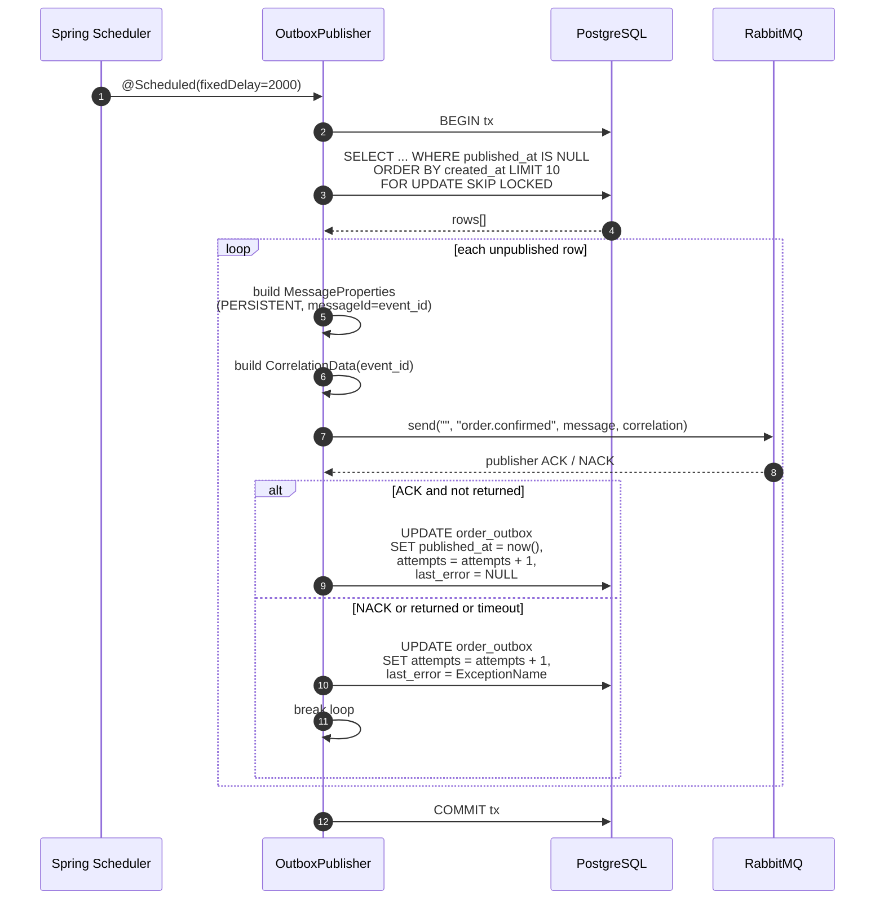

# Outbox Publishing and Messaging

The orders service uses the **transactional outbox pattern** to guarantee that `order.confirmed` domain events are delivered to downstream consumers without losing messages on broker unavailability or process crashes. Instead of publishing directly to RabbitMQ during the checkout transaction, `OrderStore.finish` atomically writes an event row into `order_outbox` (see [Data Model and Persistence](data-model.md)). A background `OutboxPublisher` component polls that table and forwards each row to RabbitMQ with publisher confirms.

This decouples the acknowledgment path inside the checkout saga from the availability of the message broker.

## Spring AMQP Configuration

`application.properties` enables correlated publisher confirms, returned-message tracking, mandatory routing, and a tight connection timeout.

| Property | Value | Purpose |
|---|---|---|
| `spring.rabbitmq.publisher-confirm-type` | `correlated` | Each `RabbitTemplate.send` can request a per-message `CorrelationData` future that the broker ACKs or NACKs. |
| `spring.rabbitmq.publisher-returns` | `true` | Enables `returnedMessage` callbacks for unroutable messages. |
| `spring.rabbitmq.template.mandatory` | `true` | Messages are returned by the broker if they cannot be routed to any queue. |
| `spring.rabbitmq.connection-timeout` | `3000` | Connection establishment times out after 3 seconds. |

(`repo://src/main/resources/application.properties#L10-L13`)

In addition to the mandatory/publisher-confirms setup, `OutboxPublisher` also sets the `PERSISTENT` delivery mode on every outbound message (`repo://src/main/java/com/commercelens/orders/OutboxPublisher.java#L26`), so the broker writes messages to disk before acknowledging.

## Queue Declarations

`OutboxPublisher` declares the live queue and its dead-letter companion as Spring `@Bean` methods so they are created automatically on startup.

### `order.confirmed` (live queue)

- **Durable** (`true`) — survives broker restart.
- **Dead-letter exchange** `""` (the default exchange).
- **Dead-letter routing key** `order.confirmed.dead`.

`repo://src/main/java/com/commercelens/orders/OutboxPublisher.java#L19`

### `order.confirmed.dead` (dead-letter queue)

- **Durable** (`true`) — survives broker restart with no extra arguments.

`repo://src/main/java/com/commercelens/orders/OutboxPublisher.java#L20`

Messages that fail to be delivered to a consumer (for example after maximum retries on the consumer side) are routed by the broker to `order.confirmed.dead` for later inspection.

## Outbox Event Payload

When `OrderStore.finish` commits a confirmed order, it also inserts a single event into `order_outbox` with this JSON payload shape:

```json
{
  "eventId": "order-confirmed-{orderId}",
  "orderId": "...",
  "customerEmail": "...",
  "totalCents": ...,
  "trackingNumber": "..."
}
```

The `eventId` is deterministic (`order-confirmed-` + the order UUID) and used by consumers for deduplication. All data comes from the fields of the `Checkout.Order` instance at the moment the saga reaches `confirmed` (`repo://src/main/java/com/commercelens/orders/OrderStore.java#L24-L26`).

## Publish Loop

`OutboxPublisher.publish` runs every two seconds under a `@Scheduled(fixedDelay = 2000)` annotation (`repo://src/main/java/com/commercelens/orders/OutboxPublisher.java#L21`).

The single-iteration flow is:

1. **Begin local transaction** via `TransactionTemplate.executeWithoutResult`.
2. **Select unpublished rows** — up to ten rows from `order_outbox WHERE published_at IS NULL`, ordered by `created_at`, locked with `FOR UPDATE SKIP LOCKED` so that multiple publisher instances (or concurrent scheduler threads) do not contend for the same rows (`repo://src/main/java/com/commercelens/orders/OutboxPublisher.java#L24`).
3. **For each row**:
   - Build a `MessageProperties` block with content type `application/json`, `PERSISTENT` delivery mode, and `messageId` set to the row `event_id`.
   - Wrap the event in `CorrelationData(event_id)`.
   - Send the message to the default exchange (`""`) with routing key `order.confirmed` via `RabbitTemplate.send`.
   - **Await the confirm** up to five seconds (`correlation.getFuture().get(5, TimeUnit.SECONDS)`) (`repo://src/main/java/com/commercelens/orders/OutboxPublisher.java#L29`).
   - **Verify ACK** and absence of returned messages. If the broker NACKs or returns the message, an exception is thrown.
4. **On success**, update the row: `published_at = now()`, `attempts = attempts + 1`, `last_error = NULL` (`repo://src/main/java/com/commercelens/orders/OutboxPublisher.java#L31`).
5. **On failure**, catch the exception, increment `attempts`, store the exception simple class name in `last_error`, and break the loop so that subsequent rows are left for the next poll (`repo://src/main/java/com/commercelens/orders/OutboxPublisher.java#L32`).

The outer transaction spans both the `SELECT ... FOR UPDATE SKIP LOCKED` and the `UPDATE`, but the RabbitMQ send itself is external; the *local commit* only happens after the confirm is received, so a crash between sending and the broker ACK would leave the row unpublished for redelivery.



**Caption:** Spring-scheduled outbox publish loop, showing the per-row publisher-confirm handshake and the local-transaction commit.

## At-Least-Once Delivery Semantics

The architecture guarantees **at-least-once delivery**, not exactly-once. Consumers must deduplicate messages by `eventId`. Because:

- A crash after the broker ACKs but before the local `UPDATE` finishes means the row remains unpublished. The next scheduled poll re-sends the same message because the local transaction did not commit.
- A crash before the broker ACKs also leaves the row unpublished.
- Network partitions, broker restarts, or slow broker queues can all delay confirmation beyond the five-second timeout, causing a retry.

The `order_outbox` table acts as the single source of published truth. Broker outages have no effect on the checkout saga itself: the order is already confirmed and the event simply stays pending until connectivity is restored and the next poll succeeds.

## Operational Notes

- **Dead-letter queue**: Messages that cannot be consumed after retries end up in `order.confirmed.dead`. Monitoring the dead queue is the primary operational signal for poison or malformed events.
- **Attempt counter**: The `attempts` column can be queried to detect rows that are stuck after many retries.
- **Timeouts**: The 5-second confirm timeout and 3-second connection timeout mean publisher threads block only briefly. A heavily degraded broker will not exhaust the scheduler pool.
- **Related pages**: See [Checkout Saga](checkout-saga.md) for the saga that writes events into the outbox, [Data Model and Persistence](data-model.md) for the `order_outbox` schema, and [Service Context](../service-context.md) for the overall runtime topology.
