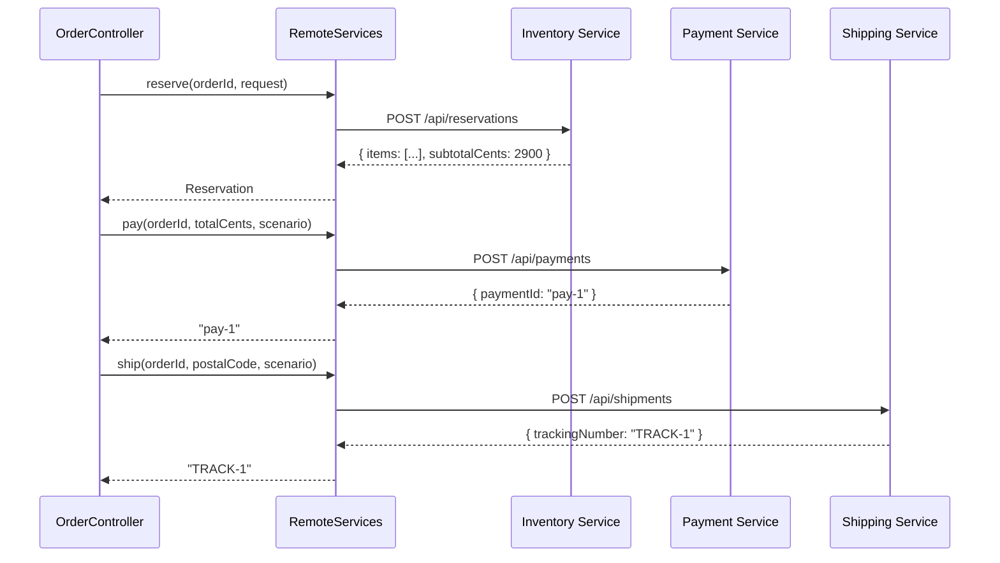

# External Service Integrations

The checkout saga delegates every remote side effect to `RemoteServices`, a Spring component that implements the `Checkout.Ports` interface with `java.net.http.HttpClient`. This page documents the exact HTTP contracts, configuration, and validation rules that govern how the order service communicates with the Inventory, Payment, and Shipping providers.

## Service URLs

Downstream base URLs are injected via `@Value` from `application.properties`:

- `inventory.url` → `${INVENTORY_URL:http://localhost:8081}` (`repo://src/main/resources/application.properties#L14`)
- `payment.url` → `${PAYMENT_URL:http://localhost:8081}` (`repo://src/main/resources/application.properties#L15`)
- `shipping.url` → `${SHIPPING_URL:http://localhost:8081}` (`repo://src/main/resources/application.properties#L16`)

## HTTP Client Configuration

`RemoteServices` builds a shared `HttpClient` with a **2-second connect timeout**:

`repo://src/main/java/com/commercelens/orders/RemoteServices.java#L16`

Every request is further constrained by an **8-second request timeout** set inside `request()`:

`repo://src/main/java/com/commercelens/orders/RemoteServices.java#L20`

```java
private final HttpClient client = HttpClient.newBuilder()
    .connectTimeout(Duration.ofSeconds(2))
    .build();

// inside request(...)
var builder = HttpRequest.newBuilder(URI.create(url))
    .timeout(Duration.ofSeconds(8))
    .header("Content-Type", "application/json");
```

Transport failures (`IOException`, `InterruptedException`) or timeouts are surfaced as `Checkout.RemoteFailure` with status `504`.

## Downstream Contracts

All JSON bodies are sent and received through an internal `request` helper. Each port method maps to a specific HTTP method and URL.

### Inventory Service

| Port Method | HTTP Method | Endpoint | Request Body | Success Response Mapping |
|---|---|---|---|---|
| `products()` | `GET` | `{inventory.url}/api/products` | none | raw `JsonNode` |
| `reserve(orderId, request)` | `POST` | `{inventory.url}/api/reservations` | `{"orderId":"...","items": [...]}` | `items` array + `subtotalCents` |
| `release(orderId)` | `POST` | `{inventory.url}/api/reservations/{orderId}/release` | empty JSON object (`{}`) | none (fire-and-forget) |

`repo://src/main/java/com/commercelens/orders/RemoteServices.java#L27-L28,L32`

`reserve` converts the response into a `Checkout.Reservation` by extracting:
- `items` as a `List<Map<String,Object>>`
- `subtotalCents` as a `long`

If `subtotalCents` is negative or `items` is `null`, `RemoteServices` throws `Checkout.RemoteFailure(502, "invalid inventory response")`.

### Payment Service

| Port Method | HTTP Method | Endpoint | Request Body | Success Response Mapping |
|---|---|---|---|---|
| `pay(orderId, cents, scenario)` | `POST` | `{payment.url}/api/payments` | `{"orderId":"...","amountCents":...,"currency":"USD","scenario":"..."}` | `paymentId` string |
| `refund(paymentId, orderId)` | `POST` | `{payment.url}/api/payments/{paymentId}/refund` | `{"orderId":"..."}` | none (fire-and-forget) |

`repo://src/main/java/com/commercelens/orders/RemoteServices.java#L29,L33`

The `paymentId` returned by `pay` is validated via `required(...)` — it must be present and non-blank.

### Shipping Service

| Port Method | HTTP Method | Endpoint | Request Body | Success Response Mapping |
|---|---|---|---|---|
| `ship(orderId, postalCode, scenario)` | `POST` | `{shipping.url}/api/shipments` | `{"orderId":"...","postalCode":"...","scenario":"..."}` | `trackingNumber` string |

`repo://src/main/java/com/commercelens/orders/RemoteServices.java#L30`

The `trackingNumber` is also validated via `required(...)` and must be non-blank.

## Successful Checkout Sequence



**Caption:** `RemoteServices` calls inventory reservation, then payment, then shipping during a successful checkout.

## Response Validation

### HTTP Status Check

`RemoteServices` requires the upstream to return HTTP `2xx`. Any response outside the `200–299` range is treated as an error (`repo://src/main/java/com/commercelens/orders/RemoteServices.java#L22-L23`):

```java
if (response.statusCode() < 200 || response.statusCode() >= 300) {
    // throws Checkout.RemoteFailure(...)
}
```

### Error Body Parsing

When a non-2xx response arrives, `RemoteServices` attempts to parse the body as JSON and extract a human-readable message. The logic prefers the `message` field, then falls back to `detail`, and finally defaults to a generic string (`repo://src/main/java/com/commercelens/orders/RemoteServices.java#L23`):

```java
JsonNode error = json.readTree(response.body());
message = error.path("message").asText(error.path("detail").asText(message));
```

If the body cannot be parsed, the original generic message is kept.

### Required Field Validation

`required(JsonNode body, String key)` reads a string field and ensures it is non-blank (`repo://src/main/java/com/commercelens/orders/RemoteServices.java#L31`):

```java
String value = body.path(key).asText();
if (value.isBlank())
    throw new Checkout.RemoteFailure(504, "invalid provider response; outcome uncertain");
```

This guard prevents accepting a `200 OK` response that is structurally valid but semantically empty for:
- `paymentId` (Payment → `pay`)
- `trackingNumber` (Shipping → `ship`)

### Exception Mapping

| Condition | Resulting `RemoteFailure` Status | Notes |
|---|---|---|
| Upstream returns 4xx or 5xx | Upstream HTTP status | Parsed error message or generic message |
| Transport/timeout/interrupt | `504` | Message: "upstream response unavailable; outcome may be uncertain" |

`repo://src/main/java/com/commercelens/orders/RemoteServices.java#L25`

## Test Double: FakePorts

`CheckoutTest` uses `FakePorts` as the unit-test stand-in for `RemoteServices` (`repo://src/test/java/com/commercelens/orders/CheckoutTest.java#L50-L57`). It is a plain Java class that implements `Checkout.Ports` and accepts failure injections so that the saga state machine can be exercised without making real HTTP calls.

```java
static class FakePorts implements Checkout.Ports {
    Checkout.RemoteFailure paymentFailure;
    boolean shippingFailure, refundFailure, released, refunded;
    int shippingStatus = 422;
    // ... implements reserve, pay, ship, release, refund
}
```

`FakePorts` is **not** a mock framework object — it is a hand-written test double that records side effects (`released`, `refunded`) and throws configured exceptions on demand. The production adapter (`RemoteServices`) is never instantiated during these unit tests.

## Related Pages

- [Checkout Saga](../architecture/checkout-saga.md) — saga state machine and `Ports` contract
- [Service Context](../service-context.md) — runtime topology and environment wiring
- [Failure Handling](../workflows/failure-handling.md) — operational runbooks for `manual_review` and `payment_unknown` reconciliation
