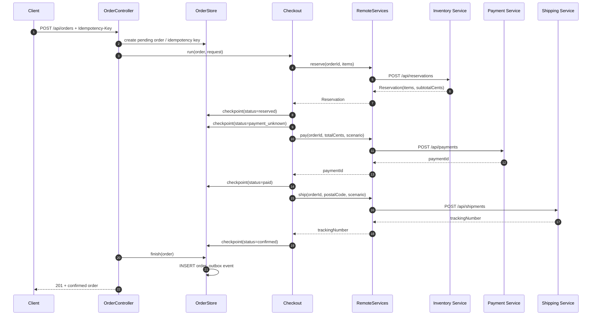

# CommerceLens Order Service — Service Context

## Identity

| Attribute | Value |
|---|---|
| **Purpose** | Checkout coordinator — orchestrates inventory reservation, payment authorization, shipping creation, and durable outbox publishing. |
| **Group / Artifact** | `com.commercelens` / `order-service` |
| **Version** | `0.1.0` |
| **Entry point** | `OrderApplication.java`, port `8080` |
| **Technology stack** | Java 21, Spring Boot 3.4.2, PostgreSQL, RabbitMQ |

The service is a local demonstration coordinator; it does not implement authentication and should be exposed only through a loopback-bound portal.

## Provided Interfaces

### HTTP Endpoints

All routes are served on the configured `server.port` (default `8080`).

| Method | Route | Purpose | Source |
|---|---|---|---|
| `GET` | `/health` | Database readiness; returns `200` when PostgreSQL answers `SELECT 1`, otherwise `503`. | `OrderController` lines 14 |
| `GET` | `/api/products` | Proxies the inventory catalog. | `OrderController` lines 15 |
| `GET` | `/api/orders` | Returns the latest 200 orders, newest first. | `OrderController` lines 16 |
| `GET` | `/api/orders/{id}` | Returns persisted order details; `404` if absent. | `OrderController` lines 17 |
| `POST` | `/api/orders` | Creates an order via the checkout saga. Requires an `Idempotency-Key` header (1–100 characters: letters, numbers, hyphens, underscores). | `OrderController` lines 18–24 |

#### `POST /api/orders` request and response

Request body:
```json
{"customerEmail":"customer@example.com","postalCode":"10001","items":[{"sku":"BOOK-001","quantity":1}],"paymentScenario":"success","shippingScenario":"success"}
```

- `paymentScenario` and `shippingScenario` accept `"success"`, `"decline"` (payment only), `"timeout"` (payment only), and `"failure"` (shipping only).
- Idempotency is enforced by the `Idempotency-Key` header plus a SHA-256 hash of the canonical request body.
- Reusing a key with identical input returns the original outcome without external calls.
- Reusing a key with different input returns `409 Conflict`.
- Requests already in progress return their latest persisted state and `409`.
- On success the response is `201`; failures return the persisted order with `id`, `status`, and `failureReason`.

### Published Events

| Queue | Exchange | Dead-Letter Routing Key | Purpose |
|---|---|---|---|
| `order.confirmed` | Default exchange (`""`) | `order.confirmed.dead` | Emitted after an order reaches `confirmed`. Durable, with publisher confirms. Consumers must deduplicate by `eventId`. |

The `order.confirmed.dead` queue is also durable and receives messages that cannot be routed.

Evidence:
- Routes and idempotency rules: `OrderController` [lines 18–25](repo://src/main/java/com/commercelens/orders/OrderController.java#L18-L25)
- Queue declarations with DLX: `OutboxPublisher` [lines 19–20](repo://src/main/java/com/commercelens/orders/OutboxPublisher.java#L19-L20)
- Event payload and outbox insertion: `OrderStore` [lines 23–27](repo://src/main/java/com/commercelens/orders/OrderStore.java#L23-L27)

## Checkout Business Flow

The checkout saga proceeds through the states below. Each state change is persisted so that a crash can be inspected and reconciled, not replayed blindly.



*Checkout flow from the idempotent POST through saga steps to RemoteServices and final persistence with outbox event.*

### State machine

States are advanced in this order, with possible terminal branches:

1. **pending** — order and idempotency record created.
2. **reserved** — inventory reserved; `totalCents` computed.
3. **payment_unknown** — uncertainty persisted before calling the payment provider.
4. **paid** — payment authorized.
5. **confirmed** — shipment created and order finalized.

Terminal failure/review branches:
- **failed** — definite inventory decline (4xx), definite payment decline (`402`), or definite shipping rejection (4xx) after successful refund.
- **manual_review** — 5xx/timouts from inventory, payment, or shipping, or any compensation failure (refund or stock release).

Evidence:
- Saga states and branching logic: `Checkout` [lines 39–59](repo://src/main/java/com/commercelens/orders/Checkout.java#L39-L59)
- Controller orchestration: `OrderController` [lines 18–23](repo://src/main/java/com/commercelens/orders/OrderController.java#L18-L23)

## Consumed Dependencies

### Outbound HTTP services (runtime dependencies)

| Target | URL configuration | Endpoint called | Purpose |
|---|---|---|---|
| Inventory Service | `INVENTORY_URL` | `POST /api/reservations`, `POST /api/reservations/{id}/release`, `GET /api/products` | Reserve and release stock; proxy catalog. |
| Payment Service | `PAYMENT_URL` | `POST /api/payments`, `POST /api/payments/{paymentId}/refund` | Authorize and refund payments. |
| Shipping Service | `SHIPPING_URL` | `POST /api/shipments` | Create shipments. |

All outbound HTTP calls use:
- **Request timeout**: 8 seconds (`Duration.ofSeconds(8)`)
- **Connect timeout**: 2 seconds (`Duration.ofSeconds(2)`)
- **No blind retry** after uncertain outcomes (e.g. timeouts, 5xx, transport errors).

Evidence:
- Timeout configuration: `RemoteServices` [lines 16–20](repo://src/main/java/com/commercelens/orders/RemoteServices.java#L16-L20)
- HTTP methods and paths: `RemoteServices` [lines 27–33](repo://src/main/java/com/commercelens/orders/RemoteServices.java#L27-L33)

### Databases

| Database / Table | Purpose | Schema |
|---|---|---|
| PostgreSQL `orders` | Durably stores order JSONB bodies, idempotency keys, request hashes, HTTP status, and timestamps. | `schema.sql` [lines 1–8](repo://src/main/resources/schema.sql#L1-L8) |
| PostgreSQL `order_outbox` | Transactional outbox for `order.confirmed` events pending RabbitMQ delivery. | `schema.sql` [lines 9–16](repo://src/main/resources/schema.sql#L9-L16) |

No caches are used.

### Messaging

| Role | Broker | Queue / Topic |
|---|---|---|
| Publisher | RabbitMQ | `order.confirmed` (default exchange, durable, with DLX to `order.confirmed.dead`) |

No inbound event subscriptions exist.

### Package dependencies

Key runtime dependencies declared in `pom.xml`:

| Dependency | Scope |
|---|---|
| `spring-boot-starter-web` | compile |
| `spring-boot-starter-jdbc` | compile |
| `spring-boot-starter-amqp` | compile |
| `postgresql` | runtime |
| `spring-boot-starter-test` | test |

Evidence: `pom.xml` [lines 6–12](repo://pom.xml#L6-L12)

## Dependency Table

| Direction | Relationship Type | Target Identifier | Interface/Topic | Configuration Variable | Supporting Evidence | Certainty |
|---|---|---|---|---|---|---|
| Outbound | HTTP client | Inventory Service | `POST /api/reservations`, `POST /api/reservations/{id}/release`, `GET /api/products` | `INVENTORY_URL` | `RemoteServices` [lines 16–20, 27–33](repo://src/main/java/com/commercelens/orders/RemoteServices.java#L16-L33) | Definite |
| Outbound | HTTP client | Payment Service | `POST /api/payments`, `POST /api/payments/{paymentId}/refund` | `PAYMENT_URL` | `RemoteServices` [lines 16–20, 29–33](repo://src/main/java/com/commercelens/orders/RemoteServices.java#L16-L33) | Definite |
| Outbound | HTTP client | Shipping Service | `POST /api/shipments` | `SHIPPING_URL` | `RemoteServices` [lines 16–20, 30](repo://src/main/java/com/commercelens/orders/RemoteServices.java#L16-L33) | Definite |
| Outbound | JDBC | PostgreSQL | `orders` table, `order_outbox` table | `SPRING_DATASOURCE_URL` (alias `ORDER_DATABASE_URL`), `SPRING_DATASOURCE_USERNAME`/`PASSWORD` | `application.properties` [lines 2–4](repo://src/main/resources/application.properties#L2-L4); `schema.sql` [lines 1–16](repo://src/main/resources/schema.sql#L1-L16) | Definite |
| Outbound | AMQP publisher | RabbitMQ | `order.confirmed` queue, `order.confirmed.dead` DLQ | `SPRING_RABBITMQ_HOST`/`PORT`/`USERNAME`/`PASSWORD` (aliases `RABBITMQ_HOST`/`PORT`/`USER`/`PASSWORD`) | `application.properties` [lines 6–13](repo://src/main/resources/application.properties#L6-L13); `OutboxPublisher` [lines 19–20](repo://src/main/java/com/commercelens/orders/OutboxPublisher.java#L19-L20) | Definite |
| Mock/Unit test | In-memory stub | FakePorts (test-only) | `Checkout.Ports` interface | N/A | `CheckoutTest` [lines 50–57](repo://src/test/java/com/commercelens/orders/CheckoutTest.java#L50-L57) | Test-only; not a runtime dependency |

## Failure Behavior

The checkout saga encodes strict failure semantics to avoid double financial effects.

### Timeouts and connectivity

- All external HTTP requests have an **8-second request deadline** and a **2-second connect timeout**.
- Transport errors and 5xx responses from downstream services leave the order in `manual_review` (inventory, shipping) or `payment_unknown` (payment) because the outcome may have succeeded at the provider.

### Retry and idempotency

- **No blind retry** is performed after uncertain outcomes.
- **Idempotency** is enforced by the `Idempotency-Key` header combined with a **SHA-256 hash of the canonical request body** (sorted items, normalized scenarios). Duplicate keys with identical input return the stored result; duplicate keys with different input return `409`.
- Concurrent duplicate-key requests are serialized by PostgreSQL `UNIQUE` constraint on `idempotency_key`.

### Compensation

- **Payment decline** (`402`): releases the inventory reservation.
- **Shipping rejection** (4xx): refunds the payment and releases the reservation.
- **Compensation failure** (refund or release throws): transitions the order to `manual_review` because stock or funds may be in an intermediate state.

### Uncertainty states

- **`payment_unknown`**: persisted before calling the payment provider. A crash after `reserved` but before `paid` allows an operator to query the provider and reconcile manually.
- **`manual_review`**: used for 5xx/timeouts from inventory or shipping, and for any failed compensation. The order intentionally blocks automatic replay.

### Dead-letter queue

Messages that cannot be routed from `order.confirmed` are forwarded to `order.confirmed.dead`. Outbox delivery is **at-least-once**; consumers must deduplicate by `eventId`.

Evidence:
- Failure semantics in saga: `Checkout` [lines 39–59](repo://src/main/java/com/commercelens/orders/Checkout.java#L39-L59)
- Timeout configuration: `RemoteServices` [lines 16–20](repo://src/main/java/com/commercelens/orders/RemoteServices.java#L16-L20)
- Idempotency and hashing: `OrderController` [lines 20–25](repo://src/main/java/com/commercelens/orders/OrderController.java#L20-L25)
- Concurrent idempotency test: `OrderStoreTest` [lines 15–26](repo://src/test/java/com/commercelens/orders/OrderStoreTest.java#L15-L26)
- Checkout failure tests: `CheckoutTest` [lines 14–48](repo://src/test/java/com/commercelens/orders/CheckoutTest.java#L14-L48)

## Configuration and Observability

### Environment variables

The following variables configure the service. Spring-standard names take precedence; aliases exist for local convenience.

| Service / Concern | Primary Variable | Alias | Default (local only) |
|---|---|---|---|
| Database URL | `SPRING_DATASOURCE_URL` | `ORDER_DATABASE_URL` | `jdbc:postgresql://localhost:5432/orders` |
| Database username | `SPRING_DATASOURCE_USERNAME` | `ORDER_DATABASE_USER` | `commerce` |
| Database password | `SPRING_DATASOURCE_PASSWORD` | `ORDER_DATABASE_PASSWORD` | `commerce-local-only` |
| Inventory base URL | `INVENTORY_URL` | — | `http://localhost:8081` |
| Payment base URL | `PAYMENT_URL` | — | `http://localhost:8082` |
| Shipping base URL | `SHIPPING_URL` | — | `http://localhost:8083` |
| RabbitMQ host | `SPRING_RABBITMQ_HOST` | `RABBITMQ_HOST` | `localhost` |
| RabbitMQ port | `SPRING_RABBITMQ_PORT` | `RABBITMQ_PORT` | `5672` |
| RabbitMQ username | `SPRING_RABBITMQ_USERNAME` | `RABBITMQ_USER` | `commerce` |
| RabbitMQ password | `SPRING_RABBITMQ_PASSWORD` | `RABBITMQ_PASSWORD` | `commerce-local-only` |

Additional Spring properties:
- `spring.rabbitmq.publisher-confirm-type=correlated`
- `spring.rabbitmq.publisher-returns=true`
- `spring.rabbitmq.template.mandatory=true`
- `spring.rabbitmq.connection-timeout=3000`
- `spring.sql.init.mode=always`

Evidence: `application.properties` [lines 1–17](repo://src/main/resources/application.properties#L1-L17)

### Health check

- `GET /health` queries `SELECT 1` via the `JdbcTemplate`. Returns `200` when PostgreSQL is reachable, otherwise `503`.

### Logs and runtime setup

- The Docker image runs as an unprivileged `app` user on Alpine JRE 21.
- The application JAR is built from `order-service-0.1.0.jar` and exposed on port `8080`.

Evidence:
- Health endpoint: `OrderController` [line 14](repo://src/main/java/com/commercelens/orders/OrderController.java#L14)
- Dockerfile: `Dockerfile` [lines 1–13](repo://Dockerfile#L1-L13)
- Application entry point: `OrderApplication` [lines 1–9](repo://src/main/java/com/commercelens/orders/OrderApplication.java#L1-L9)

## Related Documentation

- [API Surface](architecture/api-surface.md)
- [Checkout Saga](architecture/checkout-saga.md)
- [Data Model](architecture/data-model.md)
- [Outbox Publishing](architecture/outbox-publishing.md)
- [External Services](integrations/external-services.md)
- [Configuration](operations/configuration.md)
- [Quickstart](quickstart.md)
- [Test Strategy](testing/test-strategy.md)
- [Failure Handling](workflows/failure-handling.md)
