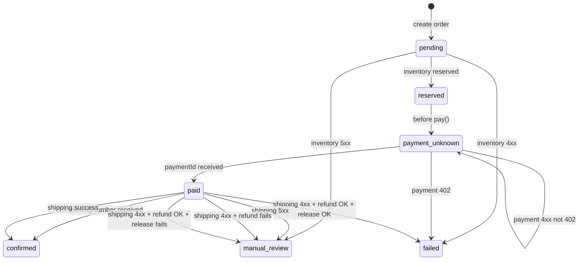

# Checkout Saga — Failure Handling

> Post-generation review: corrected state labels and uncertainty wording against `Checkout.java`. The page was subsequently submitted and finalized through OpenWiki lifecycle validation.

This page describes every terminal and uncertainty branch in the `Checkout.run` saga. The saga is implemented in `Checkout.java` and verified in `CheckoutTest.java`. Each branch is classified as either **definite failure**, **uncertain outcome**, or **compensation failure**, and each determines whether the order ends in `failed`, `payment_unknown`, or `manual_review`.

---

## Failure State Machine

*States and terminal branches reachable from `Checkout.run`. Uncertain payment outcomes remain `payment_unknown`; uncertain inventory/shipping outcomes and compensation failures require `manual_review`. Definite failures become `failed` when required compensation succeeds.*

---

## 1. Inventory Reservation Failure

When `ports.reserve(order.id, request)` throws `RemoteFailure`:

| Remote status | Saga state | `failureReason` prefix | `httpStatus` |
|---|---|---|---|
| `4xx` (definite decline) | `failed` | `Inventory reservation: ` | downstream status |
| `5xx` (server error / timeout) | `manual_review` | `Inventory reservation: ` | `503` |

The saga does **not** attempt compensation here. An inventory timeout may have occurred after a reservation was created, so a 5xx outcome requires reconciliation; absence of an external effect is not guaranteed.

**Evidence:** `Checkout.run` reserve catch block (`Checkout.java` [lines 41](repo://src/main/java/com/commercelens/orders/Checkout.java#L41)).

---

## 2. Payment Outcomes

The saga explicitly checkpoints `payment_unknown` **before** calling the payment provider so that a crash during the call can be distinguished from "no charge was ever attempted."

### 2.1 Definite decline — `402`

The provider returned `402 Payment Required`. The saga knows the charge was not created.

- State: `failed`
- Compensation: `release(order)` — inventory reservation is released.
- `refunded` flag: **false** — no payment existed to refund.
- `httpStatus`: `402`

**Evidence:** `CheckoutTest.declineReleasesReservation` asserts `status = failed`, `released = true`, `refunded = false` (`CheckoutTest.java` [lines 20–23](repo://src/test/java/com/commercelens/orders/CheckoutTest.java#L20-L23)); `Checkout.run` payment catch with `e.status != 402` guard (`Checkout.java` [lines 45–46](repo://src/main/java/com/commercelens/orders/Checkout.java#L45-L46)).

### 2.2 Uncertain outcome — anything other than `402`

This includes `5xx`, transport timeouts, and any other `4xx` (e.g., `409` provider conflict). The saga cannot tell whether the provider created a charge.

- State: `payment_unknown`
- Compensation: **none** — the reservation is intentionally retained.
- `httpStatus`: downstream status if `4xx`; `504` if `5xx`.

Retaining the reservation is deliberate: a charge may exist, and replaying the whole saga could double-charge the customer. An operator must query the provider and reconcile manually.

**Evidence:** `CheckoutTest.timeoutKeepsReservationForReconciliation` asserts `status = payment_unknown` and `released = false` (`CheckoutTest.java` [lines 14–18](repo://src/test/java/com/commercelens/orders/CheckoutTest.java#L14-L18)). `CheckoutTest.paymentConflictRetainsReservationForReconciliation` asserts `status = payment_unknown`, `released = false`, `refunded = false` (`CheckoutTest.java` [lines 25–28](repo://src/test/java/com/commercelens/orders/CheckoutTest.java#L25-L28)).

---

## 3. Shipping Outcomes

Shipping is attempted only after payment succeeds (`paid` state).

### 3.1 Uncertain outcome — `5xx` / transport timeout

A timeout or server error may mean the carrier already accepted the shipment.

- State: `manual_review`
- Compensation: **none attempted** — payment and reservation are retained.
- `failureReason`: `Shipping: <message>`
- `httpStatus`: `502`

**Evidence:** `CheckoutTest.uncertainShipmentRetainsPaymentAndReservation` asserts `status = manual_review`, `refunded = false`, `released = false` (`CheckoutTest.java` [lines 40–43](repo://src/test/java/com/commercelens/orders/CheckoutTest.java#L40-L43)); `Checkout.run` shipping catch with `e.status >= 500` guard (`Checkout.java` [lines 49–52](repo://src/main/java/com/commercelens/orders/Checkout.java#L49-L52)).

### 3.2 Definite rejection — `4xx`

The carrier explicitly refused the shipment. The saga compensates by refunding the payment and releasing the inventory reservation.

- State: `failed` (if both compensations succeed)
- `failureReason`: `Shipping: <message>`
- `httpStatus`: `502`

**Evidence:** `CheckoutTest.shipmentFailureRefundsAndReleases` asserts `status = failed`, `released = true`, `refunded = true` (`CheckoutTest.java` [lines 30–33](repo://src/test/java/com/commercelens/orders/CheckoutTest.java#L30-L33)).

---

## 4. Compensation Failures

Compensation steps (refund and release) are themselves fallible. A failure in compensation always transitions the order to `manual_review` because stock or funds may be in an intermediate state.

### 4.1 Refund failure during shipping rejection

If `ports.refund(...)` throws while handling a shipping `4xx`:

- State: `manual_review`
- `failureReason`: appended with `; refund requires reconciliation`
- `httpStatus`: `502` (but review is required before any retry)

**Evidence:** `CheckoutTest.failedCompensationRequiresManualReview` asserts `status = manual_review` even though `released = true` (`CheckoutTest.java` [lines 35–38](repo://src/test/java/com/commercelens/orders/CheckoutTest.java#L35-L38)); `Checkout.run` refund catch inside shipping catch (`Checkout.java` [lines 53–54](repo://src/main/java/com/commercelens/orders/Checkout.java#L53-L54)).

### 4.2 Release failure

If `ports.release(order.id)` throws:

- State: `manual_review`
- `failureReason`: appended with `; stock release requires reconciliation`
- `httpStatus`: `503`

This can happen either:
- after a payment decline (`402`), because `release` is called immediately;
- during a shipping rejection, after either a successful or failed refund attempt.

**Evidence:** `Checkout.run` `release` helper (`Checkout.java` [lines 59](repo://src/main/java/com/commercelens/orders/Checkout.java#L59)).

---

## Summary Table

| Saga step | Remote code | Certainty | End state | Reservation | Payment | Action required |
|---|---|---|---|---|---|---|
| Inventory | `4xx` | Definite decline | `failed` | N/A | N/A | None |
| Inventory | `5xx` | Uncertain | `manual_review` | Unknown | N/A | Reconcile with inventory service |
| Payment | `402` | Definite decline | `failed` | Released | None | None |
| Payment | `5xx` / other `4xx` | Uncertain | `payment_unknown` | Retained | Unknown | Query payment provider |
| Shipping | `5xx` | Uncertain | `manual_review` | Retained | Retained | Query carrier |
| Shipping | `4xx` + OK refund + OK release | Definite | `failed` | Released | Refunded | None |
| Shipping | `4xx` + refund fails | Compensation failure | `manual_review` | Released | Unknown | Reconcile refund |
| Shipping | `4xx` + OK refund + release fails | Compensation failure | `manual_review` | Unknown | Refunded | Reconcile release |

---

## Related Pages

- [Checkout Saga](../architecture/checkout-saga.md) — full state machine and checkpointing details
- [Idempotency and Concurrency](idempotency-and-concurrency.md) — how uncertain states block automatic replay
- [Service Context](../service-context.md) — runtime topology, timeout configuration, and dependency table
