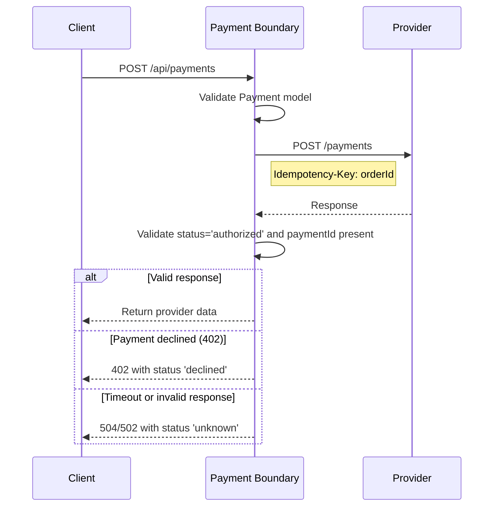
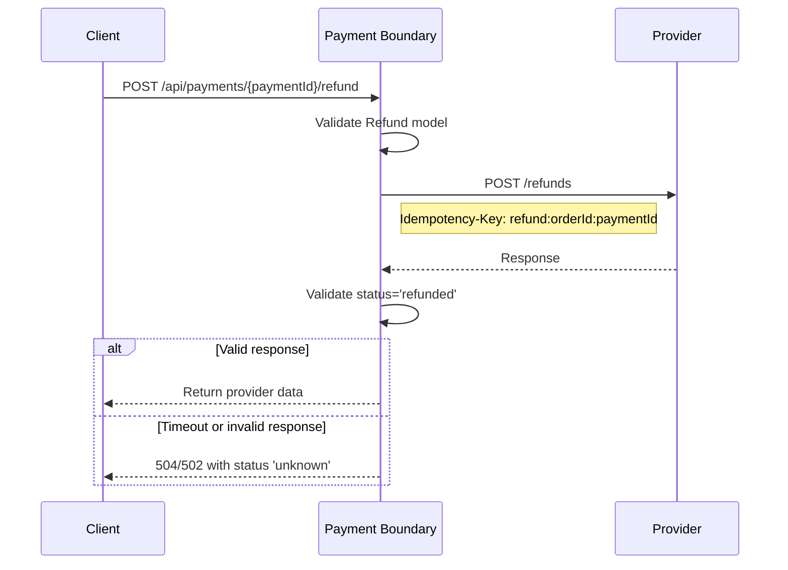

# Authorization and Refund Request Flows

The payment boundary exposes two write endpoints: one to authorize a payment and one to refund it. Both endpoints validate input with Pydantic models, forward requests to an external payment provider, and enforce strict response validation before returning data to the caller. The boundary relies on the provider to enforce durable idempotency by idempotency key.

## Provider client configuration

The [`provider_client`](../../app.py#L23-L28) dependency creates an `httpx.AsyncClient` from two environment variables:

- `PAYMENT_PROVIDER_URL` (default `http://mock-provider:8080`)
- `PROVIDER_TIMEOUT_SECONDS` (default `3`)

Both endpoints inject this client via FastAPI `Depends`.

## Shared forwarding and validation logic

The [`forward()`](../../app.py#L31-L48) function is used by both flows. It POSTs the given JSON body to the provider at the specified path with an `Idempotency-Key` header, then validates the response.

### Expected status strings per path

| Provider path | Expected status | Required field |
|---------------|-----------------|----------------|
| `/payments`   | `authorized`    | `paymentId`    |
| `/refunds`    | `refunded`      | none           |

If the response is not a dict, lacks the expected status, or (for `/payments`) lacks a `paymentId`, `forward()` raises `ValueError` and returns a 502 with status `unknown`.

### Provider HTTP status mappings

- **402** — Payment declined: returned as 402 with status `declined`.
- **409** — Conflicting idempotency key: returned as 409 with status `unknown`.
- **Other non-success** — Provider unavailable: returned as 502 with status `unknown`.

### Transport and validation failures

- **Timeout** (`httpx.TimeoutException`): returned as 504 with status `unknown`; the caller must reconcile.
- **Request error** (`httpx.RequestError`) or **invalid response** (`ValueError`): returned as 502 with status `unknown`; the caller must reconcile.

## Authorization flow

`POST /api/payments`

The [`authorize`](../../app.py#L56-L58) endpoint accepts a [`Payment`](../../app.py#L12-L18) body and delegates to `forward()` with:

- Provider path: `/payments`
- Body: the full payment payload (including `orderId`, `amountCents`, `currency`, and optional `scenario`)
- Idempotency-Key: `orderId`

The `Payment` model enforces:
- `orderId`: 1–128 characters
- `amountCents`: strictly greater than 0 and at most 100,000,000
- `currency`: only `USD`
- `scenario`: one of `success`, `decline`, `timeout` (default `success`)

_**Figure 1.** Authorization request lifecycle from client to provider and back, including validation gates and error branches._

### Authorization failure semantics

A 402 from the provider indicates a business-level decline and is returned directly to the client as a definitive outcome. Any timeout, connectivity error, or response that fails schema validation is returned as 502 or 504 with status `unknown`, signaling that the caller must reconcile the payment state before retrying.

## Refund flow

`POST /api/payments/{paymentId}/refund`

The [`refund`](../../app.py#L61-L63) endpoint accepts a [`Refund`](../../app.py#L19-L21) body and delegates to `forward()` with:

- Provider path: `/refunds`
- Body: `{"paymentId": paymentId, "orderId": refund.orderId}`
- Idempotency-Key: `refund:{orderId}:{paymentId}`

The `Refund` model enforces `orderId`: 1–128 characters.

_**Figure 2.** Refund request lifecycle, showing the distinct Idempotency-Key format and the 'refunded' status expectation._

### Refund idempotency

The refund key deliberately prefixes the refund intent (`refund:`) to distinguish it from the original payment key for the same order, preventing collisions while still allowing idempotent retries.
