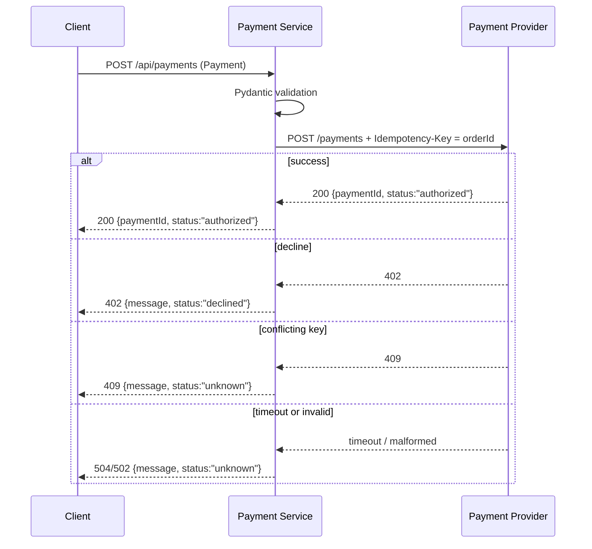

# CommerceLens Payment Service — Service Context

## Service identity and purpose

The Payment Service is the payment-authorization and refund boundary within
CommerceLens. It accepts payment and refund requests from upstream consumers,
validates input with Pydantic, assigns durable idempotency keys, forwards the
requests to an external payment provider, validates the provider response, and
returns a JSON result.

The service has **no local database, cache, event bus, or authentication**
dependencies. All write durability and idempotency are delegated to the
external provider.

## Stack and runtime

- **Language / framework:** Python 3.12, FastAPI, httpx
- **Entrypoint:** `uvicorn app:app --host 0.0.0.0 --port 8080` in `app.py`
- **Container:** Multi-stage Dockerfile (`base` → `test` / `runtime`) on
  `python:3.12-slim`, exposes port 8080, runs as UID 10001

## Provided interfaces

### Endpoints

| Method | Path | Request body | Response |
|--------|------|--------------|----------|
| `GET` | `/health` | — | `{"status":"ok"}` |
| `POST` | `/api/payments` | [`Payment`](#payment-model) | `{"paymentId":"...","status":"authorized"}` or error JSON |
| `POST` | `/api/payments/{paymentId}/refund` | [`Refund`](#refund-model) | `{"status":"refunded"}` or error JSON |

OpenAPI documentation is served at `/docs`.

### Payment model

```python
class Payment(BaseModel):
    orderId:      str   # 1–128 characters
    amountCents:  int   # >0 and ≤100_000_000, strict integer
    currency:     Literal['USD'] = 'USD'
    scenario:     Literal['success', 'decline', 'timeout'] = 'success'
```

### Refund model

```python
class Refund(BaseModel):
    orderId: str  # 1–128 characters
```

## Business flow



A refund follows the same shape: `POST /api/payments/{paymentId}/refund` with a
`Refund` body is forwarded as `POST /refunds` to the provider with
`Idempotency-Key: refund:<orderId>:<paymentId>`.

## Failure behavior

The service maps provider outcomes to explicit HTTP statuses. All ambiguous or
unrecoverable responses return `status: "unknown"` to signal that the caller must
reconcile with the provider before retrying.

| HTTP status | Meaning | Caller action |
|-------------|---------|---------------|
| `402` | Provider explicitly declined the request. | Do not retry as-is. |
| `504` | Request timed out. **A timeout does not prove that no charge occurred.** | Reconcile before retrying. No blind retries. |
| `502` | Provider returned a non-success status or an invalid/unexpected response shape. | Reconcile before retrying. |
| `409` | Provider rejected the idempotency key as conflicting with a previous payload. | Reconcile before retrying. |

## Configuration and observability

| Variable | Default | Description |
|----------|---------|-------------|
| `PAYMENT_PROVIDER_URL` | `http://mock-provider:8080` | Base URL of the external payment provider |
| `PROVIDER_TIMEOUT_SECONDS` | `3` | HTTP request timeout to the provider |

- Health check: `GET /health`
- OpenAPI docs: `GET /docs`

## Dependency table

| Direction | Type | Target | Interface | Config var | Evidence | Certainty |
|-----------|------|--------|-----------|------------|----------|-----------|
| Outbound | HTTP client | Payment provider | `POST /payments`, `POST /refunds` with JSON body and `Idempotency-Key` header | `PAYMENT_PROVIDER_URL`, `PROVIDER_TIMEOUT_SECONDS` | `app.py` | high |

The service consumes **no database, cache, message bus, or authentication**
system.

## Evidence

- [`Dockerfile`](repo://Dockerfile)
- [`app.py`](repo://app.py)
- [`README.md`](repo://README.md)
- [`tests/test_app.py`](repo://tests/test_app.py)
