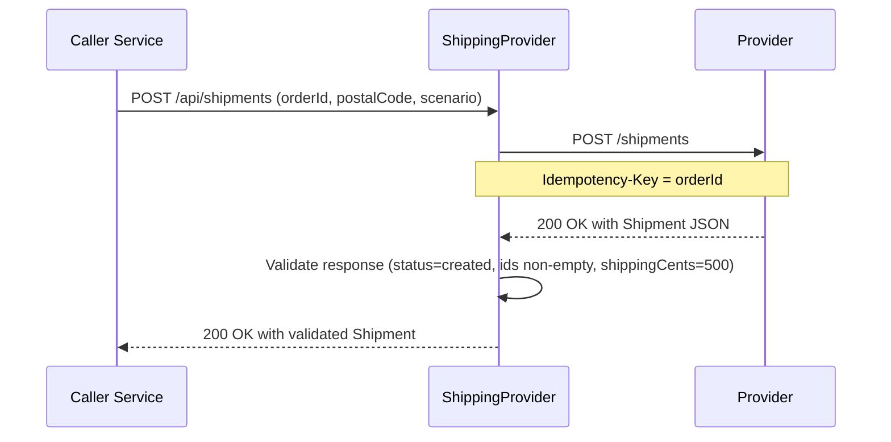
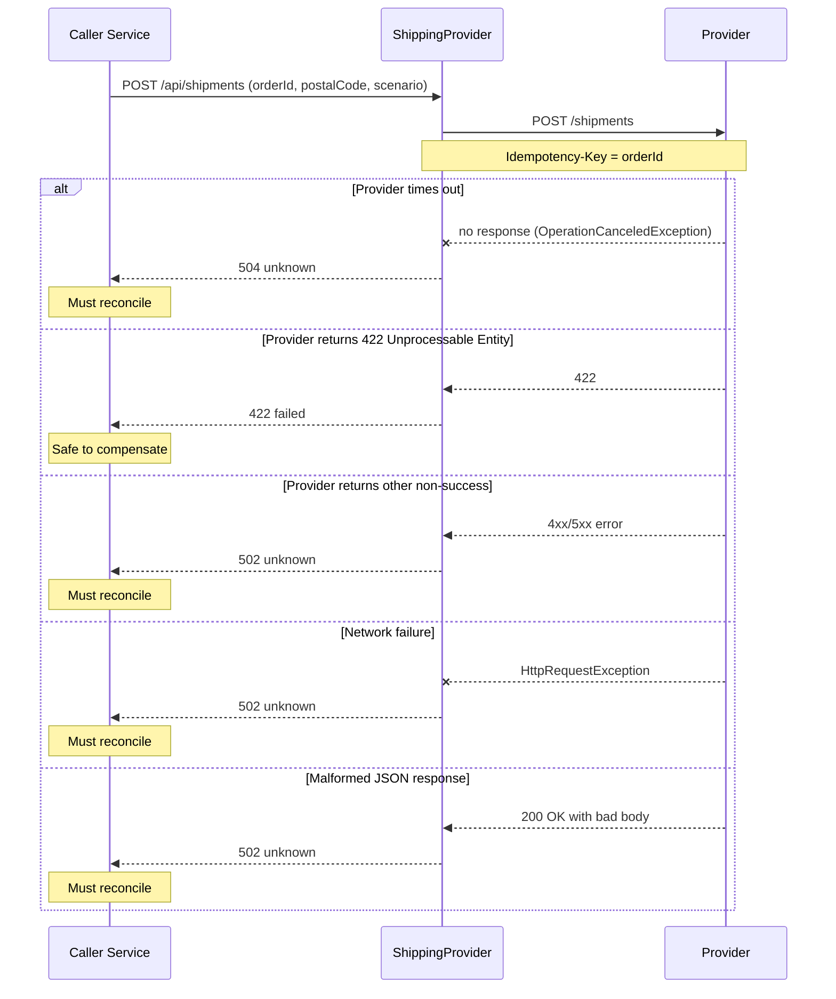

# Shipping Provider Integration

The service's sole outbound integration is an HTTP call to an external shipping provider. The default target is the CommerceLens mock provider, not a live carrier. The integration is exposed through `ShippingProvider.Create` and consumed by the local `POST /api/shipments` endpoint.

## Configuration

The `HttpClient` registered for `ShippingProvider` is configured from environment variables with hardcoded defaults.

| Variable | Default | Purpose |
|----------|---------|---------|
| `SHIPPING_PROVIDER_URL` | `http://mock-provider:8080` | Base address for all outbound requests |
| `PROVIDER_TIMEOUT_SECONDS` | `3` | Request timeout as a `double` parsed with invariant culture |

These values are bound at startup in `Program.cs` when the typed `HttpClient` is added to the service container. Changing either variable requires a process restart.

## Request contract

### Endpoint and method
- **Method:** `POST`
- **Path:** `/shipments`
- **Resolved URL:** `{BASE}/shipments`

### Headers
The provider receives an `Idempotency-Key` header whose value is the caller's `orderId`. The provider is expected to persist this key and reject requests that carry a conflicting key for a different payload. The idempotency key itself is the reconciliation handle used when outcomes become ambiguous.

### Request body (`ShipmentRequest`)
The outbound JSON body matches the incoming request shape.

| Field | Type | Constraints |
|-------|------|-------------|
| `orderId` | `string` | Required, non-empty, max 128 characters |
| `postalCode` | `string` | Required, non-empty, max 32 characters |
| `scenario` | `string` | Must be `"success"` or `"failure"` |

Validation of these constraints is performed by the local `POST /api/shipments` endpoint before the provider is invoked.

### Response body (`Shipment`)
A successful provider response must contain the following JSON fields and values:

| Field | Type | Validation rule |
|-------|------|-----------------|
| `shipmentId` | `string` | Non-empty and non-whitespace |
| `status` | `string` | Must equal `"created"` |
| `trackingNumber` | `string` | Non-empty and non-whitespace |
| `shippingCents` | `int` | Must equal `500` |

Any deviation causes the local integration to raise a `ProviderException` mapped to HTTP `502` with `status: "unknown"`.

## Happy-path sequence

The diagram below shows the normal flow when the provider accepts the request and returns a well-formed `Shipment`.

Failure and timeout branches are documented in the next section.

## Failure-mode mapping

The integration does not automatically retry ambiguous writes. Callers must reconcile when an exception or non-success status maps to `unknown`. Only an explicit `422 Unprocessable Entity` from the provider proves that no shipment was created.

| Exception / Status | HTTP code returned to caller | `status` field in response | Meaning for the caller |
|--------------------|------------------------------|----------------------------|------------------------|
| `OperationCanceledException` (timeout) | `504` | `unknown` | The provider did not respond in time. The shipment may or may not exist. Reconcile using the idempotency key. |
| `HttpRequestException` | `502` | `unknown` | Network or DNS failure. Outcome is ambiguous. Reconcile instead of assuming failure. |
| `JsonException` (malformed body) | `502` | `unknown` | Provider returned unreadable JSON. Outcome is ambiguous. |
| Provider returns `422 Unprocessable Entity` | `422` | `failed` | **Safe to compensate.** The provider explicitly rejected the request, so no shipment was created. |
| Any other non-success status from provider | `502` | `unknown` | Provider-side error with no proof of non-creation. Reconcile using the idempotency key. |

The `ProviderException` class carries three fields: a human-readable `Message`, an integer `Code` (the HTTP status returned to the caller), and a `Status` string (`"unknown"` or `"failed"`). The local endpoint catches this exception and projects it into the JSON response.

## Failure and timeout sequence

The diagram below covers the three common ambiguous failures and the single explicit rejection that is safe to compensate.

Key design invariant: **Timeouts and server failures map to `status: "unknown"`.** Callers must not treat these as definitive failures. The integration intentionally does not retry because the first write may already have succeeded on the provider side. Reconciliation should query the provider using the same `Idempotency-Key` (`orderId`) before deciding whether to issue a new request.

## Testing

The xUnit test suite in `tests/ShippingTests.cs` validates the provider contract using an in-memory `HttpMessageHandler`.

- **`PassesOrderKeyAndReturnsTracking`** — asserts that the `Idempotency-Key` header is forwarded with the `orderId` value and that a well-formed `Shipment` response is parsed correctly.
- **`FailureDoesNotProduceShipment`** — asserts that a generic `503 Service Unavailable` response results in a `ProviderException` with `Status = "unknown"` and no automatic compensation.
- **`ExplicitRejectionIsSafeToCompensate`** — asserts that a `422 Unprocessable Entity` response results in `Code = 422` and `Status = "failed"`, signalling that safe compensation is allowed.

## Operational notes

- The local service is unauthenticated. In a production deployment, provider authentication (tokens, mutual TLS, signing) belongs in a provider-specific adapter injected around the typed `HttpClient`.
- The fixed demo rate of `shippingCents: 500` hardcoded in the response validation mirrors the local `GET /api/shipping/rate` endpoint, which returns the same value. A real carrier integration would replace this with dynamic rate responses.
