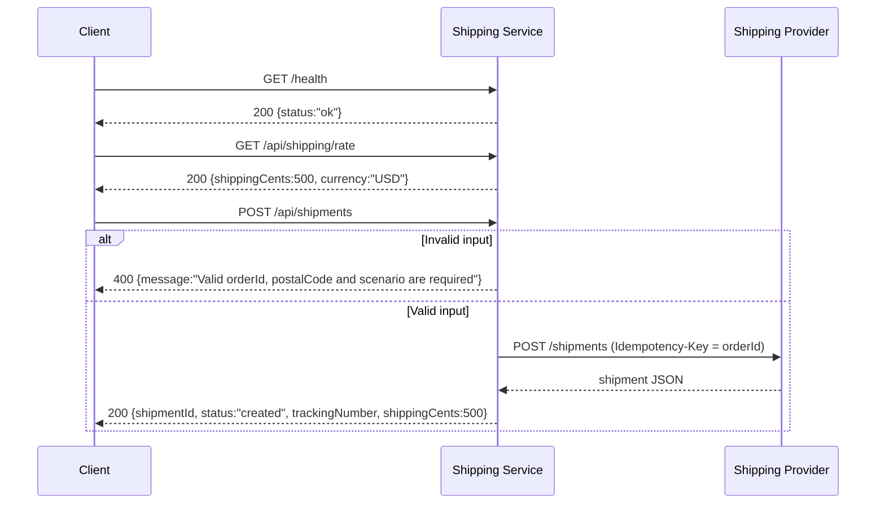
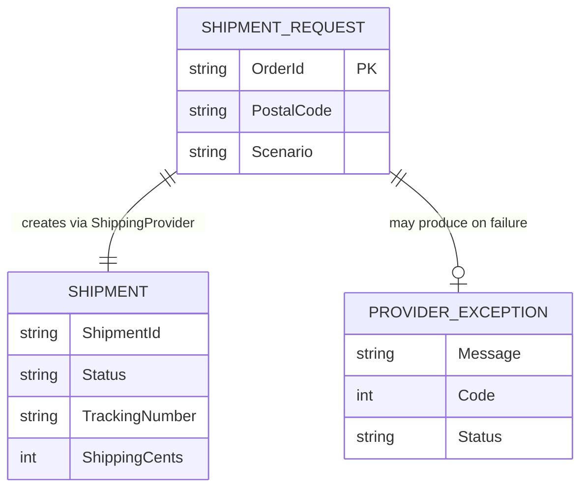

# Service Context and Operations

## Identity

The repository `commercelens-shipping-service` is a CommerceLens shipping boundary component. It is a C# / ASP.NET Core web service built for .NET 8.0.

- **Purpose:** Exposes HTTP endpoints for retrieving a fixed shipping rate and creating shipments via an external HTTP provider.
- **Stack:** ASP.NET Core on .NET 8.0 ([`Shipping.csproj`](../../Shipping.csproj#L1-L3)), using minimal APIs.
- **Entry point:** [`Program.cs`](../../Program.cs#L4-L22) bootstraps the web host on `http://0.0.0.0:8080` and registers a single `HttpClient` for [`ShippingProvider`](../../Program.cs#L26-L42).
- **Ownership evidence:** The [`README.md`](../../README.md) identifies the service as "commercelens-shipping-service" and states it is a "shipping boundary calling an external HTTP provider" with the default being the local CommerceLens mock.

## Provided Interfaces

The application exposes three HTTP endpoints:

| Method | Route | Request Body | Response Body | Status |
|--------|-------|--------------|---------------|--------|
| `GET` | `/health` | — | `{status:"ok"}` | `200` |
| `GET` | `/api/shipping/rate` | — | `{shippingCents:500,currency:"USD"}` | `200` |
| `POST` | `/api/shipments` | `{orderId,postalCode,scenario?:"success"\|"failure"}` | `{shipmentId,status:"created",trackingNumber,shippingCents:500}` | `200` |

- The [`/health`](../../Program.cs#L11) endpoint returns a static `200 OK` with `{status:"ok"}`.
- The [`GET /api/shipping/rate`](../../Program.cs#L12) endpoint returns a fixed demo rate of 500 USD cents.
- The [`POST /api/shipments`](../../Program.cs#L13-L21) endpoint accepts a [`ShipmentRequest`](../../Program.cs#L24), validates the input, delegates creation to [`ShippingProvider.Create`](../../Program.cs#L28-L42), and maps exceptions to HTTP responses.

The `POST /api/shipments` flow passes the `orderId` value as the `Idempotency-Key` header to the provider ([`Program.cs`](../../Program.cs#L30)). The provider is expected to persist idempotency and reject conflicting keys.

## Consumed Dependencies

The service depends on a single outbound HTTP dependency: the shipping provider.

| Direction | Relationship | Target Identifier | Interface | Configuration Variable | Evidence |
|-----------|-------------|-------------------|-----------|----------------------|----------|
| Outbound | HTTP client | Shipping provider | `POST /shipments` | `SHIPPING_PROVIDER_URL` | [`Program.cs`](../../Program.cs#L6-L8) |
| Outbound | HTTP client | Shipping provider | `POST /shipments` | `PROVIDER_TIMEOUT_SECONDS` | [`Program.cs`](../../Program.cs#L6-L8) |

- **`SHIPPING_PROVIDER_URL`**: Configures the [`HttpClient.BaseAddress`](../../Program.cs#L7). Default: `http://mock-provider:8080`.
- **`PROVIDER_TIMEOUT_SECONDS`**: Configures the [`HttpClient.Timeout`](../../Program.cs#L8). Default: `3` seconds.

The default provider is the local CommerceLens mock, not a live carrier ([`README.md`](../../README.md#L2)). Authentication for a production carrier belongs in a provider-specific adapter ([`README.md`](../../README.md#L12)).

## Business Flow

### Input Validation

`POST /api/shipments` validates:

- `OrderId` must be non-empty and at most 128 characters.
- `PostalCode` must be non-empty and at most 32 characters.
- `Scenario` must be either `"success"` or `"failure"`.

If validation fails, the endpoint returns `400 BadRequest` with the message `Valid orderId, postalCode and scenario are required` ([`Program.cs`](../../Program.cs#L14-L15)).

### Provider Interaction

[`ShippingProvider.Create`](../../Program.cs#L28-L42):

1. Constructs a `POST /shipments` request with JSON content from the [`ShipmentRequest`](../../Program.cs#L24).
2. Adds the `Idempotency-Key` header equal to `input.OrderId` ([`Program.cs`](../../Program.cs#L30)).
3. Sends the request via `HttpClient` with cancellation support.
4. On success (`2xx`), deserializes the response into a [`Shipment`](../../Program.cs#L25).
5. Validates the deserialized shipment: `Status` must be `"created"`, `ShipmentId` and `TrackingNumber` must be non-empty, and `ShippingCents` must equal `500` ([`Program.cs`](../../Program.cs#L39-L40)).

### Output

Successful provider interaction returns `200 OK` with a [`Shipment`](../../Program.cs#L25).

## Failure Behavior

The service maps provider and transport failures to explicit HTTP status codes and outcome statuses, with no automatic retry of ambiguous writes:

| Cause | HTTP Status | Response Body | Status | Safe to Compensate |
|-------|-------------|---------------|--------|-------------------|
| Client timeout (`OperationCanceledException`) | `504` | `{message:"Shipping provider timed out; shipment outcome unknown",status:"unknown"}` | `unknown` | No |
| Provider 5xx / transport failure (`HttpRequestException`) | `502` | `{message:"Shipping provider unavailable; shipment outcome unknown",status:"unknown"}` | `unknown` | No |
| Provider returns invalid JSON (`JsonException`) | `502` | `{message:"Invalid shipping provider response; shipment outcome unknown",status:"unknown"}` | `unknown` | No |
| Provider returns non-success (not 422) | `502` | `{message:"Shipping provider unavailable; shipment outcome unknown",status:"unknown"}` | `unknown` | No |
| Provider returns HTTP 422 | `422` | `{message:"Shipping request rejected",status:"failed"}` | `failed` | Yes |

- Only an explicit HTTP 422 (`UnprocessableEntity`) from the provider maps to `status="failed"`, which is safe to compensate because the provider proved no shipment was created ([`Program.cs`](../../Program.cs#L33-L36)).
- All other provider failures map to `status="unknown"` with a `5xx` response, meaning the caller must reconcile instead of assuming no shipment exists ([`README.md`](../../README.md#L9-L10)).
- There is **no automatic retry** of ambiguous writes ([`README.md`](../../README.md#L10)).

## Configuration and Observability

| Concern | Details |
|---------|---------|
| **Listen port** | `8080` — configured in [`Program.cs`](../../Program.cs#L5) and [`Dockerfile`](../../Dockerfile#L13) |
| **Base image** | `mcr.microsoft.com/dotnet/aspnet:8.0` runtime, `mcr.microsoft.com/dotnet/sdk:8.0` for build ([`Dockerfile`](../../Dockerfile#L1,L9)) |
| **Health check** | `GET /health` returns `{status:"ok"}` ([`Program.cs`](../../Program.cs#L11)) |
| **Environment variables** | `SHIPPING_PROVIDER_URL`, `PROVIDER_TIMEOUT_SECONDS` (see [Consumed Dependencies](#consumed-dependencies)) |
| **Authentication** | No built-in auth; the demo is unauthenticated and should be exposed only on loopback or private networks ([`README.md`](../../README.md#L16)) |
| **Tests** | xUnit tests in [`tests/ShippingTests.cs`](../../tests/ShippingTests.cs) validate provider contract behavior, idempotency-key passing, and failure mapping |

## Data Model

- [`ShipmentRequest`](../../Program.cs#L24): `{OrderId, PostalCode, Scenario="success"}`
- [`Shipment`](../../Program.cs#L25): `{ShipmentId, Status, TrackingNumber, ShippingCents}`
- [`ProviderException`](../../Program.cs#L26): `{Message, Code=502, Status="unknown"}` — thrown for provider failures and transport errors.

## Appendix: Evidence and Citations

| Claim | Source File | Line Range |
|-------|-------------|------------|
| Web host listens on `http://0.0.0.0:8080` | [`Program.cs`](../../Program.cs) | `#L5` |
| `ShippingProvider` HTTP client registration | [`Program.cs`](../../Program.cs) | `#L6-L9` |
| `GET /health` endpoint | [`Program.cs`](../../Program.cs) | `#L11` |
| `GET /api/shipping/rate` endpoint | [`Program.cs`](../../Program.cs) | `#L12` |
| `POST /api/shipments` endpoint and validation | [`Program.cs`](../../Program.cs) | `#L13-L21` |
| `ShipmentRequest` record definition | [`Program.cs`](../../Program.cs) | `#L24` |
| `Shipment` record definition | [`Program.cs`](../../Program.cs) | `#L25` |
| `ProviderException` class definition | [`Program.cs`](../../Program.cs) | `#L26` |
| `ShippingProvider.Create` implementation | [`Program.cs`](../../Program.cs) | `#L28-L42` |
| Target framework `net8.0` | [`Shipping.csproj`](../../Shipping.csproj) | `#L2` |
| Docker runtime port `8080` | [`Dockerfile`](../../Dockerfile) | `#L13` |
| xUnit contract tests | [`tests/ShippingTests.cs`](../../tests/ShippingTests.cs) | `#L4-L25` |
| Service purpose and ownership evidence | [`README.md`](../../README.md) | `#L1-L3` |
| Outcome semantics documentation | [`README.md`](../../README.md) | `#L9-L10` |
| Environment variables documentation | [`README.md`](../../README.md) | `#L12` |
| Auth and exposure warning | [`README.md`](../../README.md) | `#L16` |
