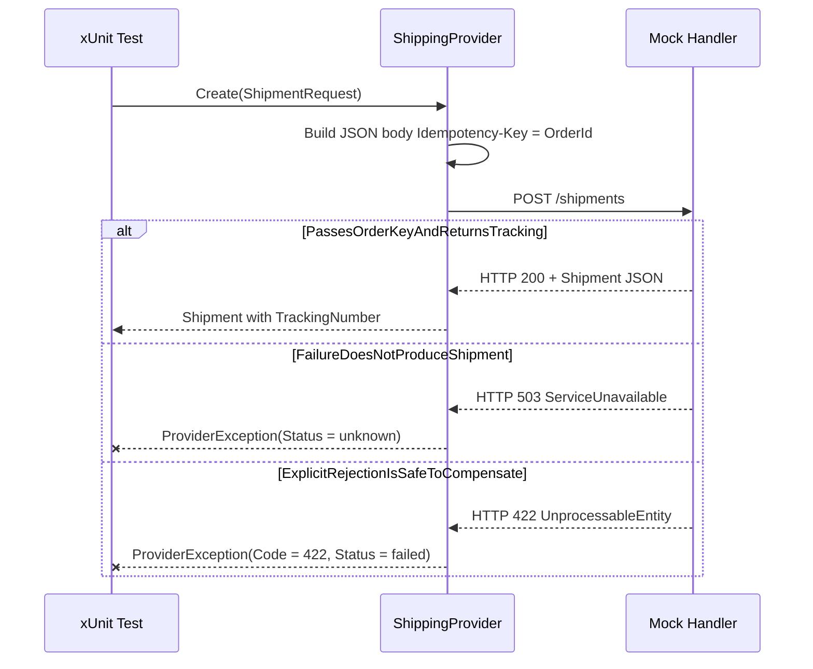

# Contract and Failure Tests

The test suite for the shipping service is an xUnit project named `Shipping.Tests` that validates the contract between the service and its shipping provider. These tests use a mock HTTP handler so they can run fast and deterministically without requiring a real provider instance. They cover happy-path request mapping, transient-failure outcomes, and explicit-rejection semantics.

## Test Project (`Shipping.Tests.csproj`)

The test project target is `net8.0` and references:

- `xunit` `2.9.3`
- `Microsoft.NET.Test.Sdk` `17.12.0`
- `xunit.runner.visualstudio` `3.0.2`
- `Shipping.csproj` (the main application)

The project is marked `<IsTestProject>true</IsTestProject>` and is not packable.

## Mock Provider (`Handler`)

All three tests inject a mock `HttpMessageHandler` named `Handler` instead of the real shipping provider.

- `Handler` is a private nested class inside `ShippingTests`.
- It exposes two public fields:
  - `string? Key` — captures the `Idempotency-Key` header value sent by `ShippingProvider` for later assertion.
  - `HttpStatusCode Code` — defaults to `HttpStatusCode.OK` and controls the HTTP response status returned by the mock.
- The overridden `SendAsync` records the header, ignores the body, and returns a JSON payload:
  ```json
  {"shipmentId":"ship-1","status":"created","trackingNumber":"track-1","shippingCents":500}
  ```

Because the payload is hard-coded, the test suite assumes that `ShippingProvider` will only return success when the response body matches this shape. The mock handler does **not** model timeout, DNS failure, or connection-reset behaviors; those paths are exercised through the real `HttpClient` stack elsewhere.

## Distinction Between Test-Time Mock and Runtime Providers

| Aspect | Test-Time Mock (`Handler`) | Runtime Provider |
|--------|---------------------------|------------------|
| Base address | `http://provider` (arbitrary) | `SHIPPING_PROVIDER_URL` env var (defaults to `http://mock-provider:8080`) |
| Response status | Configured per test (`OK`, `503`, `422`) | Actual provider response |
| Response body | Fixed JSON fixture | Real shipment JSON |
| Network | In-memory; no sockets | Real HTTP call |
| Purpose | Validate mapping and error rules | Production fulfillment |

The mock provider is used only inside unit tests to verify that `ShippingProvider` sends the right headers and maps status codes correctly. At runtime the application connects to whatever endpoint the `SHIPPING_PROVIDER_URL` environment variable specifies (typically a sandbox or production provider).

## Test Cases

### `PassesOrderKeyAndReturnsTracking`

**What it validates** — The provider correctly forwards the `Idempotency-Key` header and maps a `200 OK` response with a created shipment back to the caller.

**Setup**
- `Handler` with default `Code = HttpStatusCode.OK`

**Assertions**
1. `Assert.Equal("track-1", result.TrackingNumber);` — response tracking number is mapped.
2. `Assert.Equal("o1", handler.Key);` — the `Idempotency-Key` header equals the request's `OrderId`.

**Contract rule** — A successful shipment create must return a non-null `Shipment` with `Status == "created"`. This test exercises the branch that satisfies `ShippingProvider.Create`'s validation of `shipment.Status`, `shipment.ShipmentId`, `shipment.TrackingNumber`, and `shipment.ShippingCents`.

### `FailureDoesNotProduceShipment`

**What it validates** — A transient 5xx response from the provider does **not** imply a shipment was created, so the outcome is treated as `unknown`.

**Setup**
- `Handler` with `Code = HttpStatusCode.ServiceUnavailable`

**Assertions**
1. `await Assert.ThrowsAsync<ProviderException>(() => provider.Create(...))` — a `ProviderException` is thrown.
2. `Assert.Equal("unknown", error.Status);` — the status on the exception is `unknown`.

**Contract rule** — In `ShippingProvider.Create`, any non-success status other than `422` falls into the generic failure branch:
```csharp
throw new ProviderException("Shipping provider unavailable; shipment outcome unknown");
```
This matches the operational requirement that a 5xx does **not** prove absence of a shipment, so compensation logic must treat it as indeterminate.

### `ExplicitRejectionIsSafeToCompensate`

**What it validates** — An explicit `422 Unprocessable Entity` from the provider is a **deterministic** failure. The caller can safely retry or compensate because the provider rejected the request.

**Setup**
- `Handler` with `Code = HttpStatusCode.UnprocessableEntity`

**Assertions**
1. `await Assert.ThrowsAsync<ProviderException>(() => provider.Create(...))`.
2. `Assert.Equal(422, error.Code);` — the HTTP status code is preserved.
3. `Assert.Equal("failed", error.Status);` — the semantic status is `failed`, not `unknown`.

**Contract rule** — The `422` branch in `ShippingProvider.Create` is the only path that produces a determinate failure:
```csharp
if(response.StatusCode == System.Net.HttpStatusCode.UnprocessableEntity)
    throw new ProviderException("Shipping request rejected", 422, "failed");
```
This is the safe signal for compensating transactions or user-visible error messages.

## Cross-Reference to Provider Failure Modes

The mapping of HTTP status to `ProviderException` (and therefore to the API's HTTP response) follows these rules:

| Provider HTTP Status | `ProviderException` | Returns to API Client |
|----------------------|---------------------|----------------------|
| `200 OK` + valid body | success | `200 OK` + `Shipment` JSON |
| `200 OK` + invalid body | message: "Invalid shipping provider response; shipment outcome unknown", status: `unknown`, code: `502` | `502` |
| `422 Unprocessable Entity` | message: "Shipping request rejected", status: `failed`, code: `422` | `422` + `{message, status}` |
| Any other non-success (e.g. `503`, `500`, `404`) | message: "Shipping provider unavailable; shipment outcome unknown", status: `unknown`, code: `502` | `502` + `{message, status}` |
| `HttpRequestException` (network fault) | message: "Shipping provider unavailable; shipment outcome unknown", status: `unknown`, code: `502` | `502` + `{message, status}` |
| `JsonException` (deserialization fault) | message: "Invalid shipping provider response; shipment outcome unknown", status: `unknown`, code: `502` | `502` + `{message, status}` |
| `OperationCanceledException` (timeout) | message: "Shipping provider timed out; shipment outcome unknown", status: `unknown` | `504` + `{message, status}` |

The test suite focuses on the first three rows (success mapping, 5xx indeterminacy, and 422 determinism). Integration and end-to-end tests would cover the network-timeout and deserialization rows.

## Test Flow Diagram



*Caption: How each test configures the mock handler and what the resulting `ShippingProvider` behavior is.*

## Running the Tests

```bash
cd tests
dotnet test
```

No additional environment variables are required because the tests self-contain the mock handler.
